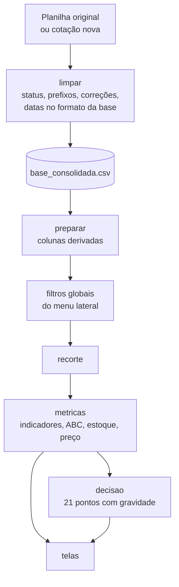
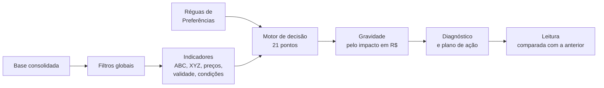

# SADPF — Documentação técnica

**Sistema de Apoio à Decisão para Pequenas Farmácias**

Este documento explica como instalar e executar o SADPF em outra máquina, como
o código está organizado, quais conceitos sustentam os cálculos e para que
serve cada biblioteca usada.

---

## Sumário

0. [Guia rápido: rodar o sistema e obter a Curva ABC](#0-guia-rápido-rodar-o-sistema-e-obter-a-curva-abc)
1. [O que é o sistema](#1-o-que-é-o-sistema)
2. [Instalação em outra máquina](#2-instalação-em-outra-máquina)
3. [Executando o sistema](#3-executando-o-sistema)
4. [Bibliotecas utilizadas](#4-bibliotecas-utilizadas)
5. [Organização do código](#5-organização-do-código)
6. [Fluxo dos dados](#6-fluxo-dos-dados)
7. [Principais conceitos e cálculos](#7-principais-conceitos-e-cálculos)
8. [Sistema de Apoio à Decisão: conceitos e funcionamento](#8-sistema-de-apoio-à-decisão-conceitos-e-funcionamento)
9. [Movimentação de estoque](#9-movimentação-de-estoque)
10. [Inclusão de novas cotações](#10-inclusão-de-novas-cotações)
11. [Verificação automática](#11-verificação-automática)
12. [Problemas comuns](#12-problemas-comuns)
13. [Histórico de mudanças](#13-histórico-de-mudanças)

---

## 0. Guia rápido: rodar o sistema e obter a Curva ABC

### O que você precisa

| Item | Onde está |
|---|---|
| Python 3.10 a 3.12 (testado no 3.12) | instale em <https://www.python.org/downloads/>; no Windows, marque **"Add python.exe to PATH"** na primeira tela do instalador |
| Internet | só na primeira execução, para baixar as bibliotecas (~400 MB) |
| A pasta `projeto_piloto` inteira | já traz código, base de dados, configuração, imagens e atalhos |

O que vem dentro da pasta:

```
INICIAR_SADPF.bat     abre o painel (Windows) — instala tudo na 1ª vez
iniciar_sadpf.sh      o mesmo para macOS / Linux
GERAR_CURVA_ABC.bat   gera a Curva ABC em Excel sem abrir o painel (Windows)
gerar_curva_abc.py    o mesmo, pelo terminal, com opções de período e base
requirements.txt      lista das bibliotecas e versões
app.py, core/, paginas/   código do sistema
dados/                base consolidada, planilha original, códigos dos
                      fornecedores (apelidos.json) e acessos (usuarios.json)
static/, assets/      fotos, logo e ícone
.streamlit/           cores do tema e configuração do servidor
verificar.py          confere a instalação e os cálculos
README.md, DOCUMENTACAO.md
```

### Passo 1 — Abrir o sistema

1. Copie a pasta `projeto_piloto` para o computador, de preferência fora do
   OneDrive/Google Drive (por exemplo, `C:\SADPF`).
2. Dê **dois cliques em `INICIAR_SADPF.bat`**. Na primeira vez uma janela preta
   mostra a instalação (alguns minutos) e, ao final, a mensagem
   *"Tudo certo. O sistema está pronto para rodar."*
3. O navegador abre em **http://localhost:8501**. Se não abrir, digite o
   endereço.
4. Entre com **empresa `Farmacia`** e **senha `123`**.
5. Deixe a janela preta aberta enquanto usa o sistema; para encerrar, feche-a.

No macOS / Linux, abra o Terminal na pasta e rode `bash iniciar_sadpf.sh`.
Para fazer o passo a passo à mão, veja as seções 2 e 3.

### Passo 2 — Ver a Curva ABC no painel

1. No menu lateral, grupo **Análise e decisão**, clique em **Curva ABC**.
2. A tela mostra, de cima para baixo:
   - **cartões das classes A, B e C** — quantos medicamentos cada classe tem,
     quanto do mix e quanto do valor ela representa;
   - **gráfico de participação** — compara a fatia de itens com a fatia de
     dinheiro de cada classe;
   - **gráfico da curva** — barras com o valor de cada item, do maior para o
     menor, e a linha âmbar do percentual acumulado, com os cortes das classes;
   - **tabela Distribuição das classes** — o resumo numérico;
   - **Ranking dos medicamentos** — todos os itens, com posição, classe, valor,
     % do total e % acumulado.
3. Para **restringir** a curva (um período, uma categoria, um fornecedor), use
   os **filtros globais** do menu lateral. A faixa *Filtros aplicados* confirma
   o que está valendo; **Limpar filtros** volta à base inteira.
4. Para **mudar o critério**, abra **Preferências → Curva ABC**:
   - *Critério de classificação* — os cortes (padrão: A até 80%, B até 95%);
   - *Base de valor* — ordenar pelo valor **faturado** (padrão) ou **pedido**.

   A escolha é salva automaticamente e vale também na próxima abertura.

### Passo 3 — Baixar a Curva ABC em Excel

**Pelo painel:** na tela Curva ABC, em *Ranking dos medicamentos*, clique em
**Baixar Curva ABC (Excel)**. A planilha sai com os filtros e as preferências
que estão valendo na tela.

**Sem abrir o painel:** depois de ter rodado o `INICIAR_SADPF.bat` ao menos uma
vez, dê dois cliques em **`GERAR_CURVA_ABC.bat`**. Ele gera
`saidas\curva_abc.xlsx` com a base inteira e abre o arquivo.

**Pelo terminal, com opções** (na pasta do projeto):

```powershell
.venv\Scripts\python.exe gerar_curva_abc.py                                   # base inteira
.venv\Scripts\python.exe gerar_curva_abc.py --inicio 01/01/2025 --fim 31/12/2025
.venv\Scripts\python.exe gerar_curva_abc.py --base pedido --saida abc_pedido.xlsx
```

| Opção | O que faz |
|---|---|
| `--base pedido` ou `--base faturado` | valor que ordena a curva (sem a opção, vale o das Preferências) |
| `--inicio dd/mm/aaaa` / `--fim dd/mm/aaaa` | limita o período das compras |
| `--saida arquivo.xlsx` | nome e local do arquivo (padrão: `saidas/curva_abc.xlsx`) |

No macOS / Linux, troque `.venv\Scripts\python.exe` por `.venv/bin/python`.

A planilha tem três abas:

| Aba | Conteúdo |
|---|---|
| **Resumo das classes** | classe, nº de medicamentos, % dos medicamentos, valor, % do valor, unidades, valor médio por item |
| **Ranking ABC** | todos os medicamentos em ordem: posição, código, nome, categoria, classe, valor, % do total, valor acumulado, % acumulado, unidades, pedidos e fornecedores |
| **Parâmetros** | período, base de valor, cortes usados, total classificado e concentração nos 20% maiores — para saber exatamente como a curva foi calculada |

Com a base original e as configurações padrão, o resultado esperado é:
**classe A 306 medicamentos (31,9% do mix, 80% do valor), B 312 (32,5%, 15%),
C 342 (35,6%, 5%)**, sobre R$ 216.798,38 de valor faturado.

### Como ler o resultado

- **Classe A** — os poucos itens que concentram ~80% do dinheiro: controle
  individual, negociação de preço, acompanhamento de validade.
- **Classe B** — controle intermediário, revisão periódica.
- **Classe C** — muitos itens de pouco valor: compra simplificada, em bloco.
- Nesta base a classe A é grande (31,9% dos itens) porque a maioria dos
  medicamentos foi comprada uma única vez; a curva é mais "achatada" que o
  padrão 80/20. Isso é característica dos dados, não erro de cálculo (veja a
  seção 7.1).

### Usando em um notebook (opcional)

```python
from core import dados as D, metricas as M, parametros as PR
from core.exportar import curva_abc_excel

p = PR.carregar()                  # preferências salvas, ou o padrão
df, _ = D.carregar_base()
abc = M.curva_abc(df, p)
abc.classes                        # resumo por classe
abc.itens.head(20)                 # os 20 primeiros do ranking
curva_abc_excel(df, abc, p, "minha_curva.xlsx")
```

---

## 1. O que é o sistema

O SADPF é um painel web que lê o histórico de cotações eletrônicas de uma
farmácia e o transforma em indicadores de compras, estoque e apoio à decisão.
Ele roda localmente: um servidor Python é iniciado no computador e o painel
abre no navegador, sem necessidade de internet depois da instalação.

**Acesso.** O painel abre numa tela de entrada, com login e cadastro de
empresa. O acesso padrão é **empresa `Farmacia`, senha `123`**. A aba *Criar
acesso* cadastra outras empresas (nome, senha e confirmação). Os acessos ficam
em `dados/usuarios.json`, que guarda só o *hash* da senha (PBKDF2-SHA256 com
sal), nunca a senha digitada. O nome é aceito sem diferenciar maiúsculas,
acentos e espaços (`farmácia` entra como `Farmacia`). O botão **Sair**, no
topo do menu lateral, encerra o acesso. Recarregar a página ou fechar a aba
também pede o login de novo. Quem abre um endereço direto (por exemplo
`/curva-abc`) cai nessa mesma tela depois de entrar.

> O login separa quem usa o painel; não é uma proteção contra quem tem acesso
> aos arquivos do computador, que pode abrir a base diretamente na pasta
> `dados/`. Para publicar o sistema na internet, veja a seção de hospedagem no
> guia do projeto: ali entram HTTPS e um login gerenciado pelo provedor.

São dezesseis telas, organizadas no menu lateral em quatro grupos:

| Grupo | Telas |
|---|---|
| — | Visão Geral |
| Compras | Gestão de Compras, Pedidos, Fornecedores, Medicamentos |
| Movimentação | Posição de Estoque, Reposição e Lotes, Validade e Remarcação |
| Análise e decisão | Curva ABC, Análises e Indicadores, Previsão de Compras, Sistema de Apoio à Decisão |
| Referência | Conceitos e Cálculos, Tutoriais, Preferências, Base de Dados |

**Menu lateral**, de cima para baixo:

1. logo do SADPF;
2. **empresa conectada** (o nome usado no login);
3. as telas, agrupadas por assunto;
4. o controle de tema escuro;
5. os **filtros globais**;
6. o botão **Sair**, fixo no rodapé — continua visível mesmo com a barra rolada.

Os filtros globais (categoria, cotação, forma farmacêutica, fornecedor,
medicamento, período e status) valem para todas as telas. A confirmação do que
está filtrado aparece em três lugares:

- no topo dos filtros, um resumo com a quantidade de filtros ativos;
- em cada filtro em uso, borda destacada, marca azul à esquerda e as opções
  escolhidas em chips azuis;
- abaixo do banner de cada tela, a faixa **Filtros aplicados**, com cada filtro e
  seus valores (não aparece em Tutoriais e Base de Dados, que não dependem dos
  filtros).

O botão **Limpar filtros (n)** mostra quantos filtros serão limpos e fica
desabilitado quando não há nenhum.

A **Visão Geral** é lida de cima para baixo (seção 8.13):

1. **Resultado do mês de referência** — compras, vendas, margem bruta e perdas
   do último mês completo, cada uma com seta e variação contra o mês anterior e
   contra o mesmo mês do ano anterior;
2. **Situação no período** — compras do recorte, estoque na data final (com a
   variação), giro com dias de estoque e o maior fornecedor;
3. **Movimentações do período** — cascata (*waterfall*) das vendas até o
   resultado com os ganhos estimados;
4. **Prioridades** — os três pontos de maior impacto, cada um com o que fazer, e
   o atalho para todos os pontos;
5. **Tendências** — um mini-gráfico por indicador (vendas, margem, perdas e
   compras), com a direção do último trimestre;
6. **Onde aprofundar** — atalhos por pergunta.

**Explicações discretas.** Em todas as telas, a explicação da aba fica no banner,
logo abaixo do nome dela (no lugar do subtítulo "Sistema de Apoio à Decisão…"),
e a explicação de cada gráfico fica num **(?)** ao lado do título, aberta ao
passar o mouse. Fórmulas e critérios de bloco (Reposição e Lotes) seguem o mesmo
padrão. Os conceitos (o que é *Estimado* e *Projeção*, premissas, fórmulas)
ficam em Conceitos e Cálculos; na tela, cada selo mostra a definição ao passar o
mouse.

**Telas de compras.**

| Tela | O que mostra |
|---|---|
| Gestão de Compras | compras do último mês fechado com comparativos (valor, pedidos, valor médio por pedido, medicamentos comprados); *Onde o gasto se concentra* (itens da classe A e sua parcela do gasto, participação dos genéricos, mês de maior gasto, fabricante de maior peso); valor pedido por mês com os picos em âmbar; categoria comercial; composição em um só gráfico, por medicamento, forma farmacêutica ou fabricante |
| Pedidos | aba *Por pedido* (clicar abre os itens) e aba *Itens comprados*, com todas as linhas de pedido e a classe ABC — a tabela que antes ficava em Gestão de Compras |
| Fornecedores | botão de privacidade na própria tela (o mesmo ajuste de Preferências); participação de cada distribuidor; ficha individual com valor por mês e, ao lado, o que se compra dele por categoria comercial ou forma farmacêutica, com um traço marcando a participação nas compras de todos |
| Medicamentos | seletor com **todos** os medicamentos do recorte (960 na base, com busca por nome ou código); quatro cartões com ação: comprar de qual fornecedor (e a economia), custo da última compra × régua de alta, margem × régua de margem apertada, próxima compra prevista pelo ritmo |

**Privacidade.** Por padrão, fornecedores e representantes aparecem com códigos
("Fornecedor A", "Representante 01"), para que a origem dos dados não seja
identificada em apresentações. O "Fornecedor A" é o de maior volume de compra.
Para ver os nomes reais, use **Preferências → Privacidade → Mostrar os nomes
originais**. Os códigos ficam fixos em `dados/apelidos.json`; a aba Base de
Dados e a exportação usam sempre os nomes originais.

**Conceitos e Cálculos** funciona como uma lista de dúvidas frequentes: 68
perguntas ("Como é calculada a margem bruta?", "Como o estoque de partida chega ao
de chegada?"), agrupadas por assunto (A base, Valores, Curva ABC, Validade,
Fornecedores, Estoque, Limitações, **Premissas** e **Telas do sistema**). Cada
resposta traz a explicação, a fórmula com o valor atual, onde o número aparece
no sistema e palavras-chave. O grupo **Premissas** reúne, em tabelas, todas as
réguas ajustáveis (valor em uso e padrão), as premissas fixas do cálculo, as
referências da literatura e como a base de movimentação foi construída
(inclusive o que é simulado). O grupo **Telas do sistema** documenta cada tela:
o que mostra, indicadores e critérios de cálculo. A busca aceita palavras sem
acento e variações ("cálculo" acha "calculada"); os resultados vêm ordenados
por relevância e os três primeiros já abertos.

**Preferências** é organizada por categoria (Privacidade, Curva ABC, Validade e
estoque, Fornecedores, Preço e margem, Compras e caixa, Régua de gravidade), com
um índice no topo e um ajuste embaixo do outro. Cada ajuste mostra o nome, a
explicação, o valor padrão, a marca **alterado** quando sai do padrão e o efeito
do valor atual sobre os dados filtrados.

**Análises e Indicadores** reúne os indicadores em oito assuntos, escolhidos no topo da tela (só o assunto aberto é calculado):

| Assunto | Indicadores |
|---|---|
| Giro e cobertura | ponte do estoque de partida ao de chegada (cascata em reais), giro, dias de estoque, cobertura na chegada, escoamento, perda sobre o disponível, compra ÷ venda, a mesma ponte por classe terapêutica, compras × custo vendido por mês e produtos por faixa de cobertura (seção 9.13) |
| Entrega e cotação | nível de atendimento, linhas com corte, valor não faturado, pedido ÷ cotado, atendimento por fornecedor, pedido × faturado por mês |
| Condições comerciais | prazo médio de pagamento (ponderado), valor com prazo curto, pedidos abaixo ou no limite do faturamento mínimo, desconto comercial, tabela por fornecedor e por representante |
| Preço e margem | margem geral, por categoria e por fornecedor; inflação de custo da cesta e índice mensal; dispersão de preço do mesmo item entre fornecedores; itens que ficaram mais caros ou mais baratos |
| Mix e sazonalidade | média mensal, meses de pico, sazonalidade das compras, participação dos genéricos, valor por fabricante, regime de preço (coluna M/L) e, com a movimentação, o índice sazonal das vendas por classe terapêutica |
| ABC × XYZ | regularidade pelas **vendas** (variação mensal, padrão quando há movimentação) ou pelas **compras** (trimestre a trimestre), cruzada com a Curva ABC |
| Ritmo de compra | intervalo médio entre compras, reposição prevista nos próximos 30 dias, validade restante e idade do lote na entrega |
| Estatística | média, mediana, moda, desvio-padrão, CV, quartis, valores atípicos (1,5 × IQR) e IC de 95%, com histograma e box-plot |

**Sistema de Apoio à Decisão: 21 pontos que reagem às Preferências.** Cada ponto guarda as réguas que o definem: o cartão avisa *Régua ajustada* quando alguma foi mudada, e o detalhe lista cada régua com o valor atual e o padrão, com atalho para Preferências. Os ajustes de Preferências são **salvos automaticamente**. No topo do painel, o quadro **Leitura** mostra a base usada; quando a leitura muda — régua ajustada, cotações novas incluídas —, o quadro **O que mudou desde a leitura anterior** explica o motivo (ex.: *Risco de validade: 6 meses → 12 meses* ou *base de dados atualizada: +120 linhas*) e lista os pontos que mudaram de valor ou de gravidade, com ▲ piorou / ▼ melhorou. As leituras ficam em `dados/leituras.json`, uma por combinação de filtros.

Pontos acrescentados nesta versão: **Classe A sem ritmo de compra** (ABC × XYZ), **Faturamento mínimo**, **Prazo de pagamento curto** e **Inflação de custo da cesta**.

**Tutoriais.** A aba Tutoriais traz 14 roteiros de vídeo em cinco trilhas. Para
publicar um vídeo, salve o `.mp4` em `assets/videos/` e preencha o campo
`video` do tutorial em `paginas/tutoriais.py` (ou use um link do YouTube).

---

## 2. Instalação em outra máquina

Para quem recebe a pasta pronta (por exemplo, a cópia `projeto_piloto`), o `LEIA-ME.md` na raiz
resume a instalação em uma página. Esta seção traz o detalhe.

### 2.1 Pré-requisitos

- **Python 3.11 ou 3.12** (testado com 3.12.10). Versões anteriores a 3.10 não
  funcionam.
- Cerca de **600 MB** livres em disco, para as bibliotecas.
- Conexão com a internet **apenas durante a instalação**.
- Um navegador atualizado (Chrome, Edge, Firefox ou Safari).

**Instalando o Python no Windows:** baixe o instalador em
<https://www.python.org/downloads/>. Na primeira tela do instalador, marque a
opção **"Add python.exe to PATH"** antes de clicar em *Install Now*.

Para conferir se o Python está disponível, abra um terminal (no Windows, o
*PowerShell*; no macOS e Linux, o *Terminal*) e rode:

```bash
python --version
```

No macOS e em algumas distribuições Linux o comando pode ser `python3`, e
vale o mesmo nos passos seguintes.

### 2.2 Copiando o projeto

Copie a pasta do projeto inteira para a outra máquina, **exceto a pasta
`.venv`**: o ambiente virtual guarda caminhos da máquina onde foi criado e não
funciona se for copiado. Ele é recriado no próximo passo.

O que precisa ir junto:

```
app.py            verificar.py       requirements.txt
DOCUMENTACAO.md   README.md          INICIAR_SADPF.bat / iniciar_sadpf.sh
core/             paginas/           assets/
static/           dados/             .streamlit/
```

A pasta `.streamlit` começa com ponto e pode ficar oculta no explorador de
arquivos. Sem ela o sistema funciona, mas perde as cores do tema e as fotos dos
banners (é o `config.toml` que liga a pasta `static/`).

**Evite instalar dentro de uma pasta sincronizada** (OneDrive, Google Drive,
Dropbox). O ambiente virtual tem milhares de arquivos e o serviço de
sincronização verifica cada um que é lido ou criado, o que deixa a primeira
abertura do painel bem mais lenta. Uma pasta como `C:\SADPF` funciona melhor;
se quiser manter cópia na nuvem, sincronize só os arquivos do projeto, não o
`.venv`.

A pasta `dados/` leva a base consolidada, as preferências salvas e o
histórico de versões. Se a intenção for começar do zero, basta levar só
`dados/cotacao_06_09.xlsx`: a base consolidada é recriada na primeira
execução.

### Jeito mais rápido: o atalho de inicialização

Com o Python instalado (seção 2.1), dê **dois cliques em `INICIAR_SADPF.bat`**
(Windows) ou rode `bash iniciar_sadpf.sh` no Terminal (macOS / Linux). Na
primeira vez o atalho cria o ambiente, instala as bibliotecas, roda o
`verificar.py` e abre o painel. Nas vezes seguintes, só abre o painel. Para
encerrar, feche a janela do terminal.

As seções 2.3 e 2.4 fazem o mesmo passo a passo, à mão.

### 2.3 Criando o ambiente e instalando as bibliotecas

Abra o terminal **dentro da pasta do projeto** (no Windows, clique com o botão
direito dentro da pasta e escolha *Abrir no Terminal*) e rode:

**Windows (PowerShell)**

```powershell
python -m venv .venv
.venv\Scripts\python.exe -m pip install --upgrade pip
.venv\Scripts\python.exe -m pip install -r requirements.txt
```

**macOS / Linux**

```bash
python3 -m venv .venv
.venv/bin/python -m pip install --upgrade pip
.venv/bin/python -m pip install -r requirements.txt
```

O primeiro comando cria um **ambiente virtual**: uma instalação isolada do
Python só para este projeto, para que as bibliotecas do SADPF não entrem em
conflito com outros programas da máquina. Os demais instalam as bibliotecas
listadas em `requirements.txt`.

Os comandos acima chamam o Python do ambiente diretamente, sem precisar
"ativá-lo". Quem preferir ativar pode usar `.venv\Scripts\activate` (Windows)
ou `source .venv/bin/activate` (macOS/Linux) e, a partir daí, usar apenas
`python` e `streamlit`.

### 2.4 Conferindo a instalação

```powershell
.venv\Scripts\python.exe verificar.py          # Windows
.venv/bin/python verificar.py                  # macOS / Linux
```

O script confere a versão do Python, as bibliotecas, a leitura da base, os
cálculos principais e a importação de cotações, sem abrir o navegador. O
resultado esperado termina com:

```
Tudo certo. O sistema está pronto para rodar.
```

---

## 3. Executando o sistema

```powershell
.venv\Scripts\python.exe -m streamlit run app.py      # Windows
.venv/bin/python -m streamlit run app.py              # macOS / Linux
```

O navegador abre sozinho em **http://localhost:8501**. Se não abrir, digite o
endereço manualmente. Entre com **empresa `Farmacia` e senha `123`**.

- **Para parar**, volte ao terminal e pressione `Ctrl + C`.
- **Para abrir em um celular ou tablet** na mesma rede Wi-Fi, use o endereço
  exibido no terminal como *Network URL* (algo como `http://192.168.0.10:8501`).
  O layout se adapta a telas pequenas.
- **Outra porta**, se a 8501 estiver ocupada:
  `... -m streamlit run app.py --server.port 8502`

O terminal precisa ficar aberto enquanto o sistema estiver em uso: é ele que
mantém o servidor funcionando.

---

## 4. Bibliotecas utilizadas

| Biblioteca | Versão testada | Para que é usada no SADPF |
|---|---|---|
| **Streamlit** | 1.64 | Transforma o código Python em aplicação web: servidor, menu lateral com seções e ícones (`st.navigation`), filtros (`st.multiselect`, `st.date_input`), tabelas, abas, envio de arquivo e o estado de cada sessão (`st.session_state`). |
| **pandas** | 3.0 | Toda a manipulação dos dados: leitura do Excel e do CSV, limpeza, colunas derivadas, filtros, agrupamentos (por fornecedor, mês, SKU), Curva ABC e junção de cotações novas. |
| **NumPy** | 2.5 | Cálculo vetorizado usado pelo pandas; no código, aparece na classificação A/B/C (`np.where`). |
| **Plotly** | 7.1 | Gráficos interativos (linhas, barras, rosca, Curva de Pareto), com zoom, dica ao passar o mouse e exportação em PNG. |
| **openpyxl** | 3.1 | Motor que o pandas usa para ler e gravar planilhas `.xlsx`. Não é chamado diretamente, mas sem ele o Excel não abre. |

Bibliotecas da própria linguagem Python também usadas: `pathlib` (caminhos de
arquivo), `dataclasses` (estruturas como `Parametros` e `Insight`), `json`
(preferências e acessos), `datetime` (carimbo das cópias de segurança),
`unicodedata` (ordenação sem acento), `html` (escape de nomes de
medicamentos), e `hashlib`, `hmac` e `secrets` (hash da senha com sal
aleatório e comparação em tempo constante, no login).

O `requirements.txt` define uma faixa de versões para cada biblioteca, com
limite superior. Isso evita que uma versão futura, com mudanças incompatíveis,
seja instalada sem aviso em outra máquina.

---

## 5. Organização do código

```
app.py                 ponto de entrada: login, menu, filtros globais, tema e roteamento
verificar.py           teste de ambiente, cálculos, importação e login
gerar_curva_abc.py     gera a Curva ABC em Excel pelo terminal (seção 0)
gerar_relatorio.py     figuras, tabelas e números do relatório de resultados (relatorio/)
gerar_resultados_tcc.py  documento de resultados em Word para o TCC (relatorio/resultados_tcc/)
LEIA-ME.md             instalação e uso em outro computador (para quem recebe a pasta)
requirements-relatorio.txt  kaleido, só para gerar as figuras do relatório
relatorio/             RELATORIO_RESULTADOS.md, figuras/ (PNG), tabelas/ (CSV), numeros.json
INICIAR_SADPF.bat      instala na 1ª vez e abre o painel (Windows)
iniciar_sadpf.sh       o mesmo para macOS / Linux
GERAR_CURVA_ABC.bat    roda o gerar_curva_abc.py e abre a planilha (Windows)
saidas/                planilhas geradas (criada na primeira exportação)
requirements.txt       bibliotecas e versões
.streamlit/config.toml cores base do tema e do menu lateral; liga a pasta static/
assets/                logo e ícone do menu
  videos/              vídeos da aba Tutoriais (ver LEIA-ME.txt)
static/                fotos dos banners e da tela de entrada, servidas como arquivo
core/                  regras e cálculos — não desenha nada na tela
  dados.py             leitura, limpeza, colunas derivadas, filtros, importação
                       e nomes codificados de fornecedores e representantes
  metricas.py          indicadores, séries, Curva ABC, estoque, preço e margem
  decisao.py           motor dos 21 pontos do apoio à decisão (26 com a movimentação)
  movimentacao.py      livro de entradas, vendas e perdas: posição, giro, cobertura,
                       ponte do estoque, ABC por vendas, ponto de pedido, propostas
                       por lote (devolver/remarcar/segregar), previsão e validação
  parametros.py        réguas de decisão e gravação das preferências
  memoria.py           guarda a Curva ABC e o apoio à decisão entre trocas de tela
  exportar.py          monta a planilha Excel da Curva ABC (botão e script)
  leituras.py          retrato de cada leitura do apoio à decisão e comparação
  previsao.py          orçamento e itens candidatos do próximo mês, com backtest
  cadastro.py          cadastro manual: montagem das linhas no formato da base,
                       validações (CNPJ, EAN, datas, duplicidade...) e modelo em Excel
  usuarios.py          cadastro e conferência dos acessos (senha em hash)
  formato.py           formatação em português (R$, %, datas, meses), sem Streamlit:
                       usada pelo motor de decisão e reexportada por tema.py
  acessibilidade.py    simulação de daltonismo e contraste das cores (verificar.py)
  tema.py              paleta, CSS e gráficos (camada de diálogo; usa o Streamlit)

Regra de camadas: os módulos de core/, exceto tema.py e memoria.py, não importam o
Streamlit. O bloco 16 do verificar.py confere isso importando a camada de modelos com
o Streamlit bloqueado. O diagrama da arquitetura é gerado por gerar_arquitetura.py
(relatorio_2/figuras/a02_arquitetura_dmd.png).
paginas/               telas — usam core/ e desenham o resultado
  acesso.py            tela de entrada: login e cadastro de empresa
  compras.py           Visão Geral, Gestão de Compras, Pedidos
  cadastros.py         Fornecedores, Medicamentos
  analitico.py         Curva ABC, Análises e Indicadores (inclui giro, ponte do estoque
                       e sazonalidade das vendas)
  movimentacao.py      Posição de Estoque, Reposição e Lotes, Validade e Remarcação
                       (com a validade no recebimento, vinda das compras)
  previsao.py          Previsão de Compras
  apoio_decisao.py     Sistema de Apoio à Decisão
  gestao.py            Conceitos e Cálculos, Preferências, Base de Dados (cotações e
                       movimentação: verificações, literatura e carga do livro)
  tutoriais.py         Tutoriais: trilhas, roteiros e vídeos
dados/
  cotacao_06_09.xlsx   planilha original (nunca é alterada)
  base_consolidada.csv base usada pelo painel
  apelidos.json        códigos fixos de fornecedores e representantes
  usuarios.json        acessos (empresa + hash da senha); criado na 1ª execução
  leituras.json        leituras do apoio à decisão, para mostrar o que mudou
  preferencias.json    criado ao salvar as preferências
  historico/           cópias da base antes de cada inclusão ou restauração
  movimentacao_estoque.csv  cópia rápida do livro de movimentação (gerada sozinha)
movimentacao/          livro de movimentação e arquivos que vieram com ele
  movimentacao_estoque.csv          livro de movimentação — fonte usada pelo sistema
  SADPF_movimentacao_estoque.xlsx   o mesmo livro em planilha (alternativa e conferência)
  02_motor_estoque.py, 04_validacao.py, 09_figuras.py, fig*.png   scripts e figuras do gerador
  proposta_remarcacao.csv           propostas do gerador: conferência das calculadas pelo
                                    sistema e restrição comercial (controlado) de cada EAN
  posicao_estoque.csv, curva_abc.csv, indicadores_sadpf.csv, movimentacao_mensal.csv,
  validacao_integridade.csv         resultados do gerador, usados na validação cruzada
  SADPF_documentacao_tecnica.pdf    como a base foi construída e o que é simulado
  historico/                        livros substituídos pela tela
```

**Separação entre cálculo e tela.** A pasta `core/` não desenha nada na tela: as funções recebem
tabelas do pandas e devolvem números e tabelas. A pasta `paginas/` só
apresenta esses resultados. Por isso os cálculos podem ser testados (como faz
o `verificar.py`) ou explorados num notebook sem abrir o painel:

```python
from core import dados as D, metricas as M
from core.parametros import Parametros

p = Parametros()
df, _ = D.carregar_base()
abc = M.curva_abc(df, p)
abc.classes                          # itens e valor por classe
M.oportunidades_fornecedor(df, p)    # economia por troca de fornecedor
```

**Nenhum número fixo no texto.** Todo limite que separa "crítico" de
"saudável" fica em `core/parametros.py`. As frases do apoio à decisão leem
esses valores, então mudar uma régua na tela Preferências muda o diagnóstico,
a cor e o texto ao mesmo tempo.

**Desempenho na troca de telas.** O Streamlit executa o `app.py` inteiro a
cada clique, por isso o que roda em toda troca precisa ser leve:

- *Cálculos vetorizados.* A moda da descrição de cada SKU (Curva ABC), o
  custo médio ponderado por fornecedor (economia na troca) e a migração de
  classe eram calculados grupo a grupo, com `apply`/`lambda`. Agora são feitos
  de uma vez, com `groupby` e operações de coluna: a Curva ABC passou de
  ~250 ms para ~25 ms e o motor de decisão de ~840 ms para ~150 ms, com
  resultados idênticos.
- *Memória por sessão* (`core/memoria.py`). A Curva ABC e os 21 pontos do
  apoio à decisão ficam guardados por uma assinatura formada pela versão da
  base, os filtros e as preferências. Trocar de tela sem mudar nada disso
  reaproveita o resultado; mudar um filtro refaz o cálculo.
- *Gráficos.* O modelo visual do Plotly é montado uma vez, ao carregar o
  módulo, e não a cada gráfico (~0,1 s por gráfico antes), e a animação de
  transição de 0,3 s foi retirada.
- *Página.* O CSS é enviado uma vez por clique (eram duas). As fotos dos
  banners saem da pasta `static/` e ficam no cache do navegador, em vez de
  ir em base64 (até 240 KB) a cada troca. O tradutor da interface examina só
  os trechos que mudaram, não a página inteira.

Medido na mesma máquina e nas mesmas condições, a troca de tela ficou cerca
de **3 vezes mais rápida** que na versão anterior.

**Gráficos legíveis em qualquer largura.** Nos gráficos de barras deitadas
(fornecedores, medicamentos, formas farmacêuticas), `core/tema.py`:

- afasta os nomes do eixo vertical do início das barras (`ticklabelstandoff`);
- quebra nomes longos em até duas linhas, com reticências se ainda sobrar
  texto. Só o rótulo muda: o nome completo continua na dica do mouse;
- aumenta a altura do gráfico conforme o número de categorias, para os nomes
  não se sobreporem.

Quando dois gráficos ficam lado a lado, as telas calculam uma altura comum
para os dois. Os eixos de valor mostram reais com ponto de milhar (R$ 9.000),
em vez da abreviação "9k".

**Ordem do menu lateral.** O Streamlit desenha o conteúdo da barra (empresa,
filtros, Sair) depois do menu de telas. Para pôr a empresa no topo sem
substituir o menu nativo, o CSS usa `display: contents` nos contêineres da
barra e reordena os blocos com `order`, a partir das chaves
`lateral_empresa` e `lateral_sair` criadas em `app.py`. O Sair usa
`position: sticky` para ficar preso ao rodapé.

---

## 6. Fluxo dos dados



1. **Leitura** (`dados.ler_arquivo`): aceita `.xlsx` e `.csv` e confere se
   todas as colunas obrigatórias estão presentes.
2. **Limpeza** (`dados.limpar`): aplica as regras do topo de `core/dados.py`.
   São elas: manter só os status listados em `STATUS_MANTIDOS` (hoje, apenas
   *Faturado*), remover prefixos da descrição (`PREFIXOS_REMOVER`) e corrigir
   cadastros conhecidos (`CORRECOES`). Também converte as datas para o formato
   da base (serial do Excel). Cada regra registra o que fez, e esse registro
   aparece na tela Base de Dados.
3. **Preparação** (`dados.preparar`): cria as colunas usadas em todo o
   sistema. São elas: data (`dt`), validade, valor pedido (quantidade pedida ×
   custo), valor faturado, margem, mês e código do produto normalizado (`sku`).
4. **Filtros** (`dados.aplicar_filtros`): o recorte escolhido no menu lateral
   segue para todas as telas.
5. **Cálculo** (`metricas`) e **decisão** (`decisao`) produzem os indicadores
   e os pontos exibidos nas telas.

A base de cada sessão é relida sempre que o arquivo em disco muda. Assim, uma
inclusão feita em outra aba do navegador também aparece nas demais.

---

## 7. Principais conceitos e cálculos

### 7.1 Curva ABC

Classifica os medicamentos pelo peso no valor de compra.

1. Soma-se o valor de cada SKU. Por padrão é o valor faturado (quantidade
   faturada × valor unitário da nota); em Preferências pode-se usar o valor
   pedido (quantidade pedida × custo).
2. Ordena-se do maior para o menor e calcula-se o percentual acumulado.
3. **Classe A** até 80% do valor acumulado; **B** até 95%; **C** o restante.
   Os cortes e a base de valor podem ser mudados em Preferências.

A classe sai do acumulado **anterior** ao item: o medicamento que cruza o
corte ainda pertence à classe que ele fecha, que é a convenção usual da curva.

Na base original: 306 itens em A (31,9% do mix e 80% do valor), 312 em B e
342 em C. Uma classe A grande não é erro. A maior parte dos medicamentos foi
comprada uma única vez, o que forma uma cauda longa e achata a curva.

### 7.2 Economia × exposição

O apoio à decisão distingue dois tipos de valor:

- **Economia**: dinheiro recuperável, como pagar o menor preço que o próprio
  histórico já registrou. Pode ser somada.
- **Exposição**: valor sob risco, como lotes perto do vencimento ou
  dependência de um fornecedor. **Não é somada**, porque o mesmo medicamento
  aparece em vários pontos e a soma contaria o mesmo dinheiro mais de uma vez.
  O painel mostra só o maior ponto de exposição.

Pela mesma razão, um medicamento que aparece em *Economia na troca de
fornecedor* não entra de novo na economia de *Custos em alta*.

### 7.3 Gravidade dos pontos

A gravidade (Crítico, Atenção, Saudável) sai do **impacto medido em reais em
relação ao total comprado**, não de um rótulo fixo:

| Tipo | Crítico a partir de | Atenção a partir de |
|---|---|---|
| Economia | 3% do valor comprado | 1% |
| Exposição | 10% | 3% |

A régua é mais dura com a economia porque dinheiro recuperável é mais urgente,
real por real, do que dinheiro apenas sob risco. Todos os limites são
ajustáveis em Preferências.

O **Plano de ação** lista todos os pontos críticos e em atenção. Primeiro vêm
os que têm valor em reais, do maior para o menor, e depois os que não têm
(como indício de erro de cadastro).

### 7.4 Validade e data de referência

A base de cotações registra **compras, não saídas**. Pelo último lote comprado,
a seção *Validade no recebimento* (tela Validade e Remarcação) indica **risco de
perda**, não posição física; a posição lote a lote vem do livro de movimentação
(seção 9).

- Usa-se o **último lote recebido** de cada medicamento.
- `meses restantes = (validade − data de referência) ÷ 30,44`
- A data de referência é a configurada em Preferências. Se a base tiver
  compras **depois** dela, vale a data da última compra: não faria sentido
  medir a validade de um lote a partir de um dia anterior à chegada dele.
- **Faixa de recebimento**: quanto restava da validade quando o lote chegou.
  *Fresco* (70% ou mais), *normal* (50–70%), *curto* (30–50%) e *crítico*
  (menos de 30%).

### 7.5 Margem bruta

```
margem = 1 − Σ(custo × quantidade) ÷ Σ(preço de venda × quantidade)
```

A margem é ponderada pela quantidade pedida e usa a mesma fórmula em todas as
telas. A média simples das margens de cada linha daria a uma compra de 1
unidade o mesmo peso de uma de 500. Linhas sem preço de venda ficam de fora.
O preço é o registrado na cotação: se a farmácia reprecificou depois, a margem
real será diferente.

### 7.6 Economia na troca de fornecedor

Para cada medicamento cotado com mais de um fornecedor, calcula-se o custo
médio ponderado de cada um. A economia de cada compra é o quanto se pagou
acima do menor custo médio. Diferenças acima de 200% entre fornecedores
indicam erro de cadastro (unidade ou digitação trocada) e ficam **fora** do
total. Frete, prazo de pagamento e faturamento mínimo não entram na conta: o
número é um ponto de partida para negociar, não uma promessa.

### 7.7 Outros indicadores

| Indicador | Fórmula |
|---|---|
| Nível de atendimento | Σ quantidade faturada ÷ Σ quantidade pedida |
| Ticket médio | valor pedido ÷ número de pedidos |
| Concentração de fornecedor | valor do maior fornecedor ÷ valor total |
| Pico mensal | mês com valor acima de 1,25 × a média mensal |
| Variação de custo | (custo da última compra − da primeira) ÷ custo da primeira |
| Prazo médio de pagamento | Σ(prazo do pedido × valor do pedido) ÷ Σ valor |
| Situação frente ao faturamento mínimo | *abaixo* se valor do pedido < mínimo; *no limite* se < mínimo × (1 + folga) |
| Pedido ÷ cotado | Σ quantidade pedida ÷ Σ quantidade cotada |
| Classificação XYZ | CV = desvio-padrão ÷ média da quantidade por trimestre; X ≤ 0,50, Y ≤ 1,00, Z acima |
| Índice de custo da cesta | 100 × Σ(custo ÷ custo da 1ª compra × peso) ÷ Σ peso, com peso = quantidade × custo inicial |
| Inflação de custo da cesta | Σ(valor × variação de custo) ÷ Σ valor, nos itens comprados mais de uma vez |
| Dispersão de preço | maior custo médio ÷ menor custo médio do mesmo item − 1 |
| Intervalo entre compras | média de dias entre as datas de compra do mesmo item |
| Validade restante na entrega | (validade − data da compra) ÷ (validade − fabricação) |
| IC de 95% da média | média ± 1,96 × desvio-padrão ÷ √n |

### 7.8 Valores observados, estimados e projetados

**Na interface.** Os números observados nos dados (compras, entradas, vendas,
saldo, perdas, giro, cobertura) aparecem **sem selo**. Dois selos marcam o que
não é observação, para não ser lido como resultado que já aconteceu:

| Selo | Significado | Exemplos |
|---|---|---|
| **Estimado** | cálculo com uma premissa declarada | economia na troca de fornecedor (menor custo alcançável), custos que subiram, validade do último lote (data de referência), perda evitável por lote (ritmo de venda até a validade), lista de compra, lote econômico, ponto de pedido, estoques mínimo e máximo |
| **Projeção** | valor futuro calculado a partir do histórico | orçamento do próximo mês, faturamento do próximo mês, faixa provável, itens candidatos de chance alta, fechamento do mês em curso e do mês seguinte (seção 9.16) |

**Realizado × estimado × projeção.** *Realizado* é o que já aconteceu dentro do
recorte (ex.: vendas de 01/07 a 08/07). *Estimado* é um valor do presente ou do
passado que não foi observado diretamente, calculado com uma premissa (ex.: a
economia possível se a compra tivesse sido feita no menor preço). *Projeção* é um
valor futuro, obtido estendendo o histórico (ex.: o fechamento de julho pelo
ritmo dos últimos 30 dias). A tela de previsão mostra os três lado a lado, com
legenda própria.

A legenda aparece no topo da Visão Geral e da lista de pontos do apoio à
decisão; os pontos o1, m1, e1, v4 e v5 levam o selo *Estimado*.

**Na documentação: a origem do dado.** A base atual combina dados reais e
simulados (seção 9.10). Essa origem não é repetida nas telas, porque o objetivo
é operar com dados reais: ao carregar um livro com as vendas do caixa, nada no
cálculo muda. Para leitura dos resultados desta versão:

| Indicador | Origem na base atual |
|---|---|
| Valor comprado, fornecedores, Curva ABC de compras, condições comerciais, preço, inflação da cesta, validade no recebimento | real (cotações) |
| Entradas do livro de movimentação | real (uma por linha faturada da cotação) |
| Estoque inicial, vendas, margem, custo vendido, Curva ABC por vendas, saldo, giro, cobertura, situação, perdas por validade, sazonalidade e XYZ pelas vendas | simulado (dependem das saídas geradas) |
| Lista de compra, lote econômico, propostas por lote, previsão pelas vendas, teste da demanda | estimado sobre saídas simuladas |
| Previsão pelas compras (orçamento e candidatos) | projeção sobre dado real |

O código preserva a origem: cada ponto do apoio à decisão que depende das saídas
carrega `simulado=True` (não exibido), e esses pontos não disputam o destaque de
**maior exposição** com os medidos sobre as compras.

### 7.9 Comparativos mensais (setas)

Os cartões de comparativo (`tema.cartao_comparativo`) usam como **mês de
referência o último mês completo** até a data final do recorte
(`metricas.mes_referencia`): comparar 8 dias de julho com junho inteiro daria
uma queda falsa. Para cada indicador, `metricas.comparar_mes` devolve o valor do
mês, do mês anterior e do mesmo mês do ano anterior, e as variações:

- valores em reais e quantidades: variação relativa, `(atual ÷ anterior) − 1`;
- margem percentual: diferença em **pontos percentuais** (p.p.);
- mês de comparação sem movimento: "jun/25 foi zero"; mês fora da base:
  "sem dado vs …" (não se inventa comparação).

| Cor da seta | Quando |
|---|---|
| verde | a variação é favorável (vendas e margem subindo, perdas caindo) |
| laranja | a variação é desfavorável |
| cinza | sem juízo de valor (compras, pedidos, estoque: subir não é bom nem ruim por si) |

Só a cor indica o juízo (a pedido, sem as palavras "melhor"/"pior"); as cores são seguras para daltonismo (seção 7.10) e, ao passar o mouse, a linha diz se a variação é favorável ou não.

Onde aparecem: Visão Geral (compras, vendas, margem bruta, perdas), Gestão de
Compras (valor pedido, pedidos, valor médio por pedido, medicamentos comprados), Posição de
Estoque (unidades vendidas, recebidas, estoque ao fim do mês) e Validade e
Remarcação (perdas em reais e unidades vencidas).

### 7.10 Cores e acessibilidade (daltonismo)

Três cores têm significado fixo: **verde** = benéfico ou saudável, **laranja**
= prejudicial ou crítico, **âmbar** = atenção. Elas estão em `core/tema.py`
(`green`, `red`, `amber`; o nome `red` foi mantido no código).

| Papel | Tema claro | Tema escuro |
|---|---|---|
| Benéfico (verde) | `#0E7563` | `#4DB6A6` |
| Prejudicial (laranja) | `#C4501F` | `#F08A4B` |
| Atenção (âmbar; texto) | `#D29B30` (`#8A5D0F`) | `#E0B04F` |
| Neutro (cascata) | `#B9CAD8` | `#B9CAD8` |
| Total (cascata) | `#235A80` | `#235A80` |

**Por que essas cores.** O verde e o vermelho anteriores (`#4D8A70` e `#B5625B`)
ficavam quase iguais para quem tem protanopia ou deuteranopia: distância de cor
CIEDE2000 de 7,6 e 10,4, respectivamente. O par atual segue a lógica da paleta
de Okabe e Ito: o verde puxa para o azul e o vermelho para o laranja, um eixo
que continua visível nesses tipos de daltonismo. A menor distância passou a 17,6
(protanopia). `core/acessibilidade.py` faz a simulação (matrizes de Machado,
Oliveira e Fernandes, 2009) e mede distância e contraste (WCAG 2.1). O bloco 16
do `verificar.py` reprova a paleta se a distância cair abaixo de 15 ou se o texto
colorido ficar abaixo de 4,5:1.

**Exceção conhecida.** Os totais da cascata usam o azul-escuro do projeto. Na
tritanopia (cerca de 0,01% das pessoas), esse azul fica próximo do verde (ΔE00
8,2). Os totais continuam identificáveis porque partem do zero e têm rótulo
próprio. Nos casos comuns (protanopia e deuteranopia) a distância é de pelo menos
18,5, e é isso que o `verificar.py` confere.

**Sinais que acompanham a cor:**

| Onde | Sinal além da cor |
|---|---|
| Comparativos | seta ▲▼ e dica ao passar o mouse ("variação favorável" ou "desfavorável") |
| Cascatas (Visão Geral, ponte do estoque) | sinal + / − no rótulo, legenda por efeito e "(estimado)" no rótulo dos valores estimados, que têm tom mais claro com contorno (sem hachura, retirada do painel a pedido) |
| Tendências | frase "▲ subindo 51%" acima do gráfico |
| Gravidade (apoio à decisão) | rótulo *Crítico*, *Atenção*, *Saudável* no selo |

**Cascatas pintadas pelo efeito, não pela direção.** Na Visão Geral, o custo do
que foi vendido é neutro (azul-claro), as perdas são prejudiciais (laranja) e os
ganhos possíveis, benéficos (verde mais suave, com contorno, por serem
estimados). Os totais ficam no azul-escuro do projeto. Na ponte do
estoque (Análises e Indicadores), o que sai vendido é verde, o que vence é
laranja e as compras, que só repõem, são azul-claro. Os totais são sempre azul-escuro. A
função é `tema.cascata`.

**Linhas sem suavização.** Os gráficos de linha ligam os meses com segmentos
retos. A curva suavizada (*spline*) criava vales e picos entre os meses que não
existem nos dados.

---
## 8. Sistema de Apoio à Decisão: conceitos e funcionamento

### 8.1 O que é um sistema de apoio à decisão

Um **Sistema de Apoio à Decisão (SAD)** é um sistema de informação que ajuda o
gestor a tomar decisões **semiestruturadas**: problemas em que há dados e
regras para orientar, mas a escolha final depende de julgamento — com quem
negociar, o que comprar de novo, quanto arriscar em validade. Ele não decide
sozinho; organiza a informação, mede o impacto e **recomenda**.

A literatura clássica (Sprague e Carlson, 1982) descreve um SAD por três
componentes. No SADPF eles são:

| Componente | O que é | No SADPF |
|---|---|---|
| **Dados** | a base sobre a qual se decide | cotações consolidadas, limpas e sem duplicidade (`core/dados.py`) |
| **Modelos** | as regras e cálculos que transformam dados em informação | indicadores, Curva ABC, XYZ e o motor dos 21 pontos (`core/metricas.py`, `core/decisao.py`), calibrados pelas réguas de `core/parametros.py` |
| **Diálogo** | a interface entre gestor e sistema | o painel de decisão, as Preferências e o quadro *O que mudou* (`paginas/apoio_decisao.py`, `paginas/gestao.py`) |

Três princípios guiam o motor:

1. **Nenhum número escrito no texto.** Tudo é calculado sobre os dados e os
   filtros em uso; a frase, a cor e a ordem acompanham.
2. **A gravidade sai do impacto, não de um rótulo.** Um ponto só é crítico se
   o dinheiro em jogo for grande frente ao total comprado.
3. **Economia e exposição não se misturam** (seção 7.2): a economia é somada,
   a exposição não, para não contar o mesmo dinheiro duas vezes.

### 8.2 Do dado à recomendação



A cada clique o sistema refaz o caminho com os dados e réguas em uso. Para
não repetir trabalho, a Curva ABC e os 21 pontos ficam guardados em memória
enquanto base, filtros e réguas não mudam (`core/memoria.py`).

### 8.3 Anatomia de um ponto

Cada ponto do painel é um registro com:

| Campo | Para que serve |
|---|---|
| valor e frase | o número principal e o que ele significa, no cartão |
| impacto (R$) e tipo | dinheiro em jogo; *economia* (recuperável) ou *exposição* (sob risco) |
| nível | Crítico, Atenção, Saudável ou Informativo |
| valores e listas | os números de apoio e os medicamentos ou fornecedores envolvidos |
| explicação | como o ponto é calculado e qual o limite da leitura |
| ação sugerida | o que fazer — também aparece no plano de ação |
| réguas | quais parâmetros de Preferências definem o ponto |

### 8.4 Os 21 pontos

| Assunto | Ponto | O que mede | Réguas (Preferências) |
|---|---|---|---|
| Curva ABC | Concentração da classe A | quanto do valor está na classe A | cortes A/B, base de valor |
| Curva ABC | Curva achatada / concentrada | valor nos 20% maiores itens × padrão de Pareto (80%) | corte A, base de valor |
| Curva ABC | Cauda de baixo valor | quantos itens são classe C e quanto valem | corte B, base de valor |
| Curva ABC | Prioridade máxima da gestão | classe A comprada várias vezes | item recorrente, corte A |
| Curva ABC | Classe A sem recorrência | classe A comprada uma única vez | corte A, régua de exposição |
| Curva ABC | Itens que subiram de classe | ABC da 1ª metade × 2ª metade do período | cortes A/B, régua de exposição |
| Curva ABC | Classe A sem ritmo de compra | valor da classe A em compra irregular (AZ) | limites X e Y, corte A |
| Oportunidades | Economia na troca de fornecedor | quanto se pagou acima do menor custo do mesmo item | diferença suspeita, régua de economia |
| Oportunidades | Indício de erro de cadastro | mesmo item com preços distantes demais | diferença suspeita |
| Fornecedores | Dependência de um fornecedor | participação do maior distribuidor | concentração crítica |
| Fornecedores | Confiabilidade de entrega | fornecedores abaixo do atendimento mínimo | atendimento mínimo, pedidos mínimos |
| Fornecedores | Classe A com fornecedor único | classe A sem alternativa cotada | corte A, régua de exposição |
| Fornecedores | Faturamento mínimo | pedidos abaixo ou no limite do mínimo | folga sobre o mínimo, régua de exposição |
| Medicamentos | Custos em alta | itens com alta de custo relevante | alta relevante, variação implausível, valor mínimo, régua de economia |
| Medicamentos | Margem apertada em itens de peso | classe A com margem abaixo do limite | margem apertada, corte A |
| Medicamentos | Inflação de custo da cesta | variação média ponderada do custo | alta relevante, variação implausível |
| Compras | Meses de maior desembolso | pico mensal frente à média | pico mensal, régua de exposição |
| Compras | Peso das maiores cotações | valor nas 3 maiores cotações | concentração em cotações |
| Compras | Prazo de pagamento curto | valor pago em prazo menor que o desejado | prazo mínimo, régua de exposição |
| Estoque | Validade dos lotes recebidos | último lote vencido ou dentro da janela de risco | risco de validade, data de referência |
| Estoque | Validade curta na entrega | fornecedor que mais entrega lote curto | linhas mínimas, régua de exposição |

### 8.5 Como cada ponto ganha sua gravidade

- **Pela régua de impacto** (a maioria): o impacto em reais é dividido pelo
  valor comprado e comparado com a régua de economia (crítico ≥ 3%, atenção
  ≥ 1%) ou de exposição (crítico ≥ 10%, atenção ≥ 3%). Sem caso, é saudável.
- **Por limite próprio**: *Dependência de um fornecedor* é crítica acima da
  concentração crítica e em atenção a partir de 3/4 dela; *Peso das maiores
  cotações* entra em atenção acima do limite; *Inflação da cesta* é crítica
  acima da alta relevante e em atenção acima da metade dela.
- **Por regra de segurança**: *Indício de erro de cadastro* é crítico sempre
  que existe; *Faturamento mínimo* nunca é saudável se houver pedido abaixo do
  mínimo.
- **Informativos**: pontos estruturais (concentração da classe A, prioridade
  máxima) descrevem a base e não carregam valor em risco.

### 8.6 Diagnóstico e plano de ação

O topo do painel resume a leitura: quantos pontos há em cada gravidade, a
**economia direta** (soma dos pontos de economia, sem contar duas vezes o mesmo
item) e o **maior ponto de exposição**. O **plano de ação** traz todos os
pontos críticos e em atenção: primeiro os que têm valor em reais, do maior para
o menor; depois os que não têm, críticos antes dos em atenção.

### 8.7 Réguas de Preferências: como o painel reage

- Cada ajuste em Preferências é **salvo automaticamente** em
  `dados/preferencias.json` e vale na hora em todas as telas.
- O cartão de um ponto cuja régua foi alterada mostra **⚙ Régua ajustada**; o
  detalhe lista cada régua com o valor atual e o padrão, e leva a Preferências.
- **Restaurar padrões** devolve todas as réguas e controles ao valor de fábrica.
- Uma régua pode mudar o valor do ponto sem mudar a gravidade — por exemplo,
  subir o risco de validade de 6 para 12 meses leva *Validade dos lotes* de 329
  para 573 itens, mas o ponto já era crítico e continua crítico. O quadro *O que
  mudou* deixa essa mudança visível.
- Nesta base, *atendimento mínimo* e *pedidos mínimos* não alteram nada: todos
  os pedidos são "Faturado" e 100% atendidos. Com pedidos parciais na base, as
  duas réguas passam a ter efeito.

### 8.8 Leituras: o que mudou desde a anterior

Cada vez que o painel é aberto, o resultado vira um **retrato** da leitura:
linhas, cotações, última compra, réguas e o nível, valor e impacto de cada
ponto (`core/leituras.py`). Se o retrato for diferente do último registrado, o
último passa a ser a **leitura anterior** e o painel mostra o quadro **O que
mudou desde a leitura anterior**, com:

- **Por quê** — base de dados atualizada (+/− linhas, cotações, nova última
  compra) e/ou réguas alteradas (*Risco de validade: 6 meses → 12 meses*);
- **Economia direta** antes → depois;
- cada ponto que mudou de valor ou de gravidade, com **▲ piorou** ou
  **▼ melhorou**.

As leituras ficam em `dados/leituras.json`, separadas por combinação de filtros
— comparar a base inteira com um único fornecedor não faria sentido — e valem
entre sessões. Reabrir a tela sem nada mudar não apaga a comparação.

### 8.9 Ciclo com dados novos

1. Na tela **Base de Dados**, a cotação nova é enviada, limpa e conferida
   contra duplicidade (seção 10).
2. Ao confirmar, a base é regravada e a versão anterior vai para o histórico.
3. A versão da base muda, a memória de cálculo é descartada e todas as telas
   recalculam com os dados novos.
4. A mensagem de sucesso traz o atalho **Ver a nova leitura no Sistema de
   Apoio à Decisão**; lá, o quadro *O que mudou* explica o efeito.

Teste realizado com uma cotação de 40 linhas em 3 pedidos — custos 40% mais
altos, lotes com validade curta e prazo de 7 dias, e um pedido abaixo do
faturamento mínimo:

| Ponto | Antes | Depois |
|---|---|---|
| Leitura | 1.657 linhas · 23 cotações · última compra 08/07/2026 | 1.697 linhas · 24 cotações · 28/07/2026 |
| Custos em alta | 24 itens (atenção) | 42 itens (**crítico**) |
| Inflação de custo da cesta | +0,7% (saudável) | +16,1% (**crítico**) |
| Faturamento mínimo | 5 pedidos (saudável) | 6 pedidos (**atenção**) |
| Economia na troca de fornecedor | R$ 8.585 | R$ 17.179 |
| Validade dos lotes recebidos | 329 itens | 342 itens |
| Classe A com fornecedor único | 45 itens (atenção) | 36 itens (**crítico**) |

No total, 18 dos 21 pontos mudaram. Reenviar o mesmo arquivo não incluiu nada;
restaurar a versão anterior gerou uma nova leitura com *−40 linhas* e devolveu
os valores originais.

### 8.10 Previsão de compras: o que dá para prever

A tela **Previsão de Compras** planeja a próxima cotação: o mês seguinte à
última compra registrada (hoje, agosto/2026). Antes de construí-la, cada método
foi testado no próprio histórico (*backtest*): para cada um dos meses com pelo
menos seis meses de histórico antes, a previsão foi refeita só com os dados
anteriores e comparada com o que de fato foi comprado.

**Prever item por item não é confiável nesta base.** Em média, 78 medicamentos
diferentes são comprados por mês, e **48% deles nunca tinham sido comprados
antes** — nenhum método baseado em histórico antecipa uma compra nova. Os
melhores métodos testados acertaram de 13% a 19% dos itens previstos:

| Método testado | Itens previstos/mês | Confirmados | Valor do mês coberto |
|---|---|---|---|
| Frequência (comprado em ≥ 15% dos meses) | 154 | 13% | 38% |
| Frequência (≥ 35% dos meses) | 17 | 19% | 7% |
| Ritmo (última compra + intervalo médio) | 59 | 15% | 14% |
| Referência: "tudo que já foi comprado" | todos | 6% | — (alcança 52% dos itens) |

**O orçamento do mês é mais previsível.** A média de todo o histórico errou
menos que a média dos últimos 3 ou 6 meses e que o último mês (erro mediano de
32%), e o gasto real ficou dentro da faixa **média ± 1 desvio** em 69% dos
meses testados.

Por isso a tela não promete um "pedido previsto". Ela mostra:

1. **Orçamento provável** — faixa de gasto do próximo mês, com o acerto dela
   no histórico.
2. **Itens candidatos** — medicamentos comprados em pelo menos dois meses, com
   **chance** (fração dos meses com compra: alta a partir de 35%, candidato a
   partir de 15%, réguas em Preferências) e **ritmo** (prevista para o mês,
   atrasada, parada há mais de dois intervalos ou mais adiante). Para cada um:
   quantidade estimada (mediana das compras), valor estimado, último
   fornecedor e o de menor custo. A lista pode ser filtrada e baixada em CSV.
3. **Confiabilidade** — taxa de confirmação de cada faixa de chance no
   histórico (alta 19%, média 13%, baixa 7%), parte do valor coberta pela
   lista e parcela de itens novos.

A previsão avança sozinha quando entram cotações novas e segue os filtros
globais. Com dados de venda ou de saída de estoque, ela poderia usar a demanda
real (giro, cobertura e ponto de pedido) em vez do ritmo de compra.

### 8.11 Limites do apoio à decisão

- A base de cotação registra **compras, não vendas**. Giro, cobertura, ruptura e
  ponto de pedido vêm do livro de movimentação, cujas vendas são **simuladas**
  (seção 9): mostram como o sistema decide, não a farmácia, até que as vendas
  reais sejam carregadas.
- O preço de venda é o da cotação; a margem real pode ser diferente.
- As estimativas de economia não incluem frete, prazo nem faturamento mínimo.
- As recomendações são pontos de partida: a decisão continua sendo do gestor.

### 8.12 Os gráficos por trás do diagnóstico

Além dos números, a tela do apoio à decisão mostra, antes da lista de pontos, um
bloco de gráficos em abas. Cada um desenha a evolução que sustenta um grupo de
recomendações, com a régua de Preferências traçada no próprio gráfico:

| Aba | O que mostra | Pontos que fundamenta |
|---|---|---|
| Valor por ponto | valor em reais de cada ponto, cor pela gravidade; pontos estimados trazem *(estimado)* no rótulo | ordem de prioridade do plano de ação |
| Compras mês a mês | valor pedido por mês com as linhas da média e do limite de pico | picos de desembolso, sazonalidade de compras |
| Custo dos medicamentos | índice de custo da cesta (100 = primeira compra) com a linha de alta da régua | inflação da cesta, custos em alta |
| Dependência de fornecedor | participação de cada fornecedor com a linha do limite de concentração | concentração de fornecedor |
| Estoque e vendas | compras e vendas por mês em barras, com as perdas por validade no eixo da direita — só com o livro de movimentação | capital parado, ruptura, perdas |

### 8.13 Visão Geral: ganhos, perdas e oportunidades

A Visão Geral mostra, numa tela, quanto se compra e se vende, onde há dinheiro
a ganhar ou em risco e o que resolver primeiro. O texto explicativo de cada
cálculo fica em **Conceitos e Cálculos**; na tela ficam os números, as setas e,
no (?) ao lado do título de cada gráfico, a explicação dele. Os selos *Estimado* e
*Projeção* mostram a definição ao passar o mouse; a legenda que os explicava saiu
desta tela. De cima para baixo:

1. **Resultado de {mês de referência}** — compras, vendas, margem bruta (% com o valor em reais no rótulo, comparada em p.p.) e
   perdas do último mês completo, cada cartão com duas setas: contra o mês
   anterior e contra o mesmo mês do ano anterior (seção 7.9). Sem livro de
   movimentação, só o cartão de compras.
2. **Situação no período** — compras do recorte, estoque na data final (com a
   variação em relação ao início, ponte da seção 9.13), giro do estoque com
   dias de estoque e o maior fornecedor.
3. **Movimentações do período** — cascata horizontal (*waterfall*) que compõe o
   resultado:

   | Passo | Natureza | Base atual |
   |---|---|---|
   | Vendas | realizado | R$ 309.650 |
   | − Custo do que foi vendido (CMV) | realizado | − R$ 189.948 |
   | = Margem bruta | subtotal | R$ 119.703 (38,7%) |
   | − Perdas por validade | realizado | − R$ 8.844 |
   | = Margem após perdas | subtotal | R$ 110.859 |
   | + Troca de fornecedor (o1) | estimado | + R$ 8.585 |
   | + Renegociação de custos (m1) | estimado | + R$ 353 |
   | + Lotes devolvidos ou remarcados (perda evitada, seção 9.14) | estimado | + R$ 5.779 |
   | = Resultado com os ganhos | estimado | R$ 125.576 |

   Sem livro de movimentação, a cascata mostra compras − economia possível =
   compras com a economia. Os riscos (dinheiro parado, ruptura, último lote
   perto do vencimento, prazo curto) não entram na soma: aparecem em
   *Prioridades*. O cálculo de cada passo e a tela onde agir ficam recolhidos em
   *Como cada valor é calculado e onde agir*.
4. **Prioridades** — os três pontos de maior impacto do apoio à decisão, cada um
   numa linha com gravidade, valor, frase-resumo e o quadro *O que fazer*; abaixo,
   com espaçamento, o atalho *Ver todos os pontos e o plano de ação*.
5. **Tendências** — quatro mini-gráficos ("pequenos múltiplos"), um por
   indicador: vendas, margem bruta, perdas e compras, nos 12 meses até o mês de
   referência. Acima de cada um, a direção: a média do último trimestre (faixa
   cinza) contra a do trimestre anterior. Abaixo de 5% de variação (ou 0,5 p.p.
   na margem), a direção é *estável*. A linha fica verde se a direção é
   favorável, laranja se é desfavorável e azul se não é boa nem ruim por si
   (compras). Embaixo vem a média dos 12 meses; o valor do mês já está nos
   cartões do topo. Substituiu o gráfico de linhas único, que tinha três séries
   em 23 meses. Na base atual: vendas subindo 51% (melhor), margem estável,
   perdas caindo 30% (melhor) e compras caindo 24%.
6. **Onde aprofundar** — seis atalhos por pergunta.

Na base atual (referência jun/26): vendas de R$ 25.282, +22,1% sobre mai/26 e
+81,8% sobre jun/25; perdas de R$ 315, −73,5% sobre mai/26 (jun/25 foi zero).

---
## 9. Movimentação de estoque

A base de cotação mostra só o que **entrou**. A pasta `movimentacao/` traz o
livro-razão completo do estoque: estoque inicial, entradas, vendas e perdas por
validade, lote a lote, com o saldo após cada movimento. Com ele o sistema passa a
medir giro, cobertura, ruptura, excesso, perda real por vencimento, Curva ABC
pelas vendas e quanto comprar de cada item.

### 9.1 Origem dos dados: o que é real e o que é simulado

| Movimento | Linhas | Origem |
|---|---|---|
| Entrada (compra) | 1.657 | **real** — uma para cada linha faturada da base de cotação |
| Estoque inicial | 429 | simulado (posição em 30/09/2024, antes do 1º pedido) |
| Venda | 21.931 | simulado a partir do ritmo real de reposição de cada item, com FEFO |
| Perda por validade | 150 | consequência das vendas simuladas: o lote que não escoou venceu |

Os números de venda **mostram como o sistema decide** e funcionam como
demonstração; eles não medem a farmácia. Como o objetivo é operar com dados
reais, as telas não repetem essa origem: ela fica registrada aqui e na seção 7.8,
e a interface marca apenas valores estimados e projeções. Quando a farmácia exportar as vendas reais no mesmo layout,
basta trocar o arquivo (seção 9.6): todo o cálculo vale igual. Como as vendas
foram calibradas pelas compras, a Curva ABC de vendas acompanha a de compras de
perto; o cruzamento das duas é demonstração do método até haver venda real.

A construção da base, as premissas e as validações do gerador estão em
`movimentacao/SADPF_documentacao_tecnica.pdf`.

### 9.2 Onde aparece no sistema

| Tela | O que a movimentação acrescenta |
|---|---|
| **Posição de Estoque** | comparativos do mês de referência (unidades vendidas, recebidas e estoque ao fim do mês, seção 7.9), estoque na data final, o que pede atenção (com atalho para a tela onde se resolve), situação de cada produto com critério e o que fazer, lista filtrável com giro e saldo de um produto ao longo do tempo |
| **Reposição e Lotes** | como o sistema decide (4 passos), política de cada produto (ponto de pedido, sob encomenda, sem venda, fora de linha), lista de compra com ajuste sazonal, **dente de serra** real × modelo com LEC, ponto de pedido e estoques mínimo e máximo, tamanho do lote e confiabilidade da demanda (WAPE) |
| **Validade e Remarcação** | comparativos das perdas (R$ e unidades), perdas por vencimento, **causas das perdas** (seção 9.15), **propostas por lote calculadas pelo sistema** (devolver, remarcar, segregar, baixa controlada — seção 9.14) e, das compras, a validade no recebimento (faixas, fornecedores e último lote de cada item) |
| **Análises e Indicadores** | assunto *Giro e cobertura* (ponte do estoque, seção 9.13), sazonalidade das vendas em *Mix e sazonalidade* e XYZ pelas vendas em *ABC × XYZ* |
| **Medicamentos** e **Gestão de Compras** | ao filtrar um único produto, o bloco de reposição dele (estoque, venda prevista, ponto de pedido, LEC, mínimo e máximo, ciclo e o dente de serra, seção 9.12) |
| **Base de Dados** | aba *Movimentação de estoque*: livro atual, verificações por bloco, indicadores × literatura e carga de um livro novo |
| **Curva ABC** | Duas visões novas: curva pelo **faturamento das vendas** e o cruzamento **compras × vendas** (dinheiro parado e itens que não podem faltar) |
| **Previsão de Compras** | Visão *Pelas vendas*: **fechamento do mês em curso e do próximo mês** (realizado × projeção, seção 9.16), faturamento do próximo mês escolhido por teste no histórico e **resumo da lista de compra**, com atalho para Reposição e Lotes (onde ficam a lista completa e o erro da demanda) |
| **Sistema de Apoio à Decisão** | Aba *Movimentação* com 5 pontos: ruptura de itens em linha, capital parado, perda por vencimento, lotes que vão vencer na prateleira e itens no ponto de pedido |
| **Preferências** | Categoria *Movimentação de estoque* com 8 réguas |
| **Conceitos e Cálculos** | grupo *Estoque* com movimentação, ponte do estoque, custo do lote, giro e cobertura, situação, sazonalidade, lote econômico, teste da demanda e remarcação |

Os filtros globais valem também aqui: o período limita os fluxos (o saldo de uma
data considera tudo o que veio antes), e os demais filtros escolhem os produtos
que sobraram no recorte de compras.

### 9.3 Cálculos

| Indicador | Cálculo |
|---|---|
| Saldo | estoque inicial + entradas − vendas − perdas (conferido movimento a movimento) |
| Demanda diária | unidades vendidas nos últimos 90 dias (régua) ÷ 90 |
| Demanda prevista | demanda diária × fator sazonal da classe terapêutica (seção 9.11) |
| Cobertura | estoque atual ÷ demanda diária |
| Giro | unidades vendidas no período ÷ estoque médio, com o estoque médio **ponderado pelo tempo** em que cada saldo ficou na prateleira |
| Valor em estoque | saldo de cada lote × custo residual do lote (entradas a custo − saídas a custo, ÷ saldo) |
| Estoque de segurança | z × desvio-padrão da venda diária × fator sazonal × √prazo de reposição (z do nível de serviço) |
| Ponto de pedido | demanda prevista × prazo de reposição + estoque de segurança |
| Quantidade sugerida | mín(demanda prevista × (prazo + cobertura desejada) + segurança, demanda prevista × 120 dias) − estoque, só para a política *ponto de pedido* |
| Curva ABC por vendas | mesma regra da de compras (cortes de Preferências, classe pelo acumulado anterior), sobre o faturamento |

Situação de cada produto, na ordem em que é testada:

| Situação | Critério (réguas de Preferências) |
|---|---|
| Ruptura | saldo zero em item em linha (reposto mais de uma vez ou comprado há menos de 180 dias) |
| Descontinuado | saldo zero e sem reposição há mais de 180 dias |
| Estoque crítico | cobertura abaixo de 15 dias |
| Validade próxima | lote mais antigo vencendo em menos de 180 dias |
| Excesso | cobertura acima de 120 dias |
| Sem giro recente | saldo positivo sem venda nos últimos 90 dias |
| Normal | nenhuma das anteriores |

### 9.4 Resultados sobre a base atual

| Indicador | Valor |
|---|---|
| Estoque ao fim (08/07/2026) | 10.423 un · R$ 68.230 a custo |
| Faturamento | R$ 309.650 · margem bruta 38,7% |
| Ponte do estoque | R$ 50.223 + R$ 216.798 − R$ 189.948 − R$ 8.844 = R$ 68.230 · giro 3,21× · 202 dias de estoque · escoamento 70,1% |
| Propostas por lote | 146 lotes: 74 remarcar, 41 devolver, 21 segregar, 7 sem margem, 3 controlados · R$ 7.004 a custo, R$ 5.779 recuperáveis |
| Perda por validade | R$ 8.844 (2,86% do faturamento) |
| Giro mediano · cobertura mediana | 1,48× · 150 dias |
| Situação | 88 ruptura · 157 descontinuados · 10 críticos · 173 validade próxima · 215 excesso · 134 sem giro · 180 normais |
| Curva ABC por vendas | A: 258 itens (29,0%) com 80,1% do faturamento · 20% maiores = 70,9% |
| Lista de compra | 117 itens no ponto de pedido, R$ 7.435 (total sugerido R$ 7.811) · políticas: 282 ponto de pedido, 134 sob encomenda, 39 sem venda recente, 502 fora de linha |
| Previsão do mês (teste em 15 meses) | "último mês" venceu, erro mediano de 8,6% (média de 6 meses: 11,0%) |
| Demanda de 30 dias por item | WAPE de 62% com ajuste sazonal, 61% pela média simples e 65% pelo método ingênuo; o ajuste reduz o viés de volume (−10% contra −16%) |

O erro item a item é alto porque a maioria dos produtos vende poucas unidades por
mês; por isso a lista usa estoque de segurança e deve ser revisada antes de cotar.

### 9.5 Validação

A aba *Movimentação de estoque* da tela Base de Dados e o bloco 14 do
`verificar.py` executam 40 verificações em oito blocos: estrutura, saldo, lotes (FEFO, vencidos, saldo por
lote), financeiro, integração com a base de cotação (cada entrada contra a sua
linha de origem), conferência com os arquivos que vieram com o livro,
remarcação e plausibilidade. Resultado atual: **36 aprovadas, 4 em atenção, 0
falhas** (inclui a comparação CSV × planilha, a **ponte do estoque fechando
centavo a centavo** e as propostas por lote do sistema contra as do arquivo do
gerador: 133 lotes em comum, mesma ação em 126). As quatro atenções são diferenças explicadas:

| Atenção | Explicação |
|---|---|
| 3 EAN com dois códigos de produto na base | 960 códigos para 957 EAN; o livro usa o EAN |
| Valor do estoque R$ 68.230 × R$ 68.335 no arquivo | o sistema avalia cada lote pelo custo residual (o que entrou a custo menos o que saiu); o arquivo, saldo × último custo |
| Classe A com 258 × 257 itens no arquivo | o arquivo fecha a classe pelo acumulado do próprio item; o sistema, pelo anterior, como na curva de compras |
| Estoque inicial R$ 50.223 × R$ 49.643 em indicadores_sadpf.csv | o livro e a documentação técnica dão R$ 50.223; o CSV de indicadores difere |

Duas diferenças de definição também foram conferidas. O **giro** do arquivo usa
(estoque inicial + final) ÷ 2; o sistema usa essa mesma fórmula no giro do
período (ponte do estoque, seção 9.13) e, por produto, o estoque médio ponderado
no tempo, que considera todo o período (mediana 1,48× contra 2,93×). A tabela de
situações do PDF (61 sem giro, 251 normais) difere do próprio CSV de posição
(134 e 178), com o qual o sistema coincide.

### 9.6 Atualizar o livro

Na tela *Base de Dados*, aba *Movimentação de estoque*, envie o livro novo
(`.csv` ou `.xlsx`). Ele só substitui o atual se não tiver nenhuma falha; o
anterior vai para `movimentacao/historico/`. Também é possível copiar o arquivo
direto para a pasta `movimentacao/`.

**Fonte usada:** o sistema lê `movimentacao/movimentacao_estoque.csv` (o mais
recente com esse nome) e, só se ele não existir, a aba *Movimentação* de
`SADPF_movimentacao_estoque*.xlsx`. Os dois foram comparados linha a linha —
24.167 movimentos com tipo, produto, lote, quantidade, valores e saldo idênticos
— e a validação repete essa comparação sempre que os dois estiverem na pasta.

### 9.7 Sazonalidade, regularidade e lote

| Análise | Como é feita | Resultado na base atual |
|---|---|---|
| **Sazonalidade por classe terapêutica** | índice mensal (100 = média da classe), com a venda de cada mês dividida pelos dias do mês no período e pelos produtos ativos da classe, para que o catálogo crescendo e os meses repetidos não se passem por estação; classes com menos de 3.000 unidades ficam marcadas como pouco volume | respiratórios: pico em julho (163), vale em fevereiro (69), inverno ÷ verão 1,83; antibióticos 1,49; dermatológicos 0,52 e antiparasitários 0,61 (verão); analgésicos estáveis (1,07) — o padrão que a literatura do setor espera (TCC, seção 2.5.3) |
| **XYZ pelas vendas** | coeficiente de variação das vendas mensais a partir da estreia do produto, com os limites X e Y de Preferências; é a XYZ como Pontes (2013) a define (variabilidade da demanda) | X 41 · Y 200 · Z 526 · 101 com menos de 6 meses; na base de compras eram 0 X, porque só havia o ritmo de compra para medir |
| **Lote econômico (LEC)** | √(2 × demanda anual × custo de pedir ÷ custo de manter), com custo de pedir de R$ 15 por item e 25% ao ano (réguas novas), **limitado a 120 dias de venda** porque o modelo de Harris supõe produto que não vence | o limite de validade manda em 872 de 889 itens: em giro lento, a fórmula clássica pediria lotes de mais de um ano; 712 itens são comprados acima do lote recomendado |
| **Estoque mínimo e máximo** | mínimo = estoque de segurança; máximo = mínimo + lote recomendado | 458 itens com saldo acima do máximo |

### 9.8 Indicadores × literatura

A aba *Movimentação de estoque* da tela Base de Dados mostra cada indicador ao lado da faixa de referência,
com a natureza do número:

| Indicador | Valor | Referência | Leitura | Natureza |
|---|---|---|---|---|
| Pareto: venda nos 20% maiores itens | 70,9% | cerca de 80% (Nguyen et al., 2022) | dentro (70–90%) | simulado |
| Perda por validade ÷ faturamento | 2,86% | 1% a 3% | dentro | simulado |
| Margem bruta | 38,7% | 25% a 50% | dentro | simulado |
| Itens em linha zerados (ruptura) | 19,3% | abaixo de 2% (TCC 2.6.3) | acima | calculado |
| Itens com cobertura de 30 a 60 dias | 10,1% | faixa recomendada (Slack et al., 2022) | abaixo | calculado |
| Cobertura mediana | 150 dias | 30 a 60 dias | acima | calculado |
| Reposições com prateleira vazia | 19,0% | 5% a 30% | dentro | calculado |
| Respiratórios: inverno ÷ verão | 1,83 | acima de 1 (sazonalidade respiratória) | dentro | simulado |

Ruptura e cobertura fora da faixa não são erro de cálculo. Elas mostram que o
ritmo real de compra é lento para a venda simulada e que boa parte do estoque
gira devagar — exatamente o que os pontos *Ruptura*, *Capital parado* e *Itens
no ponto de pedido* do apoio à decisão transformam em ação.

### 9.9 Filtros globais na movimentação

Cada filtro foi conferido num teste próprio:

| Filtro | Efeito na movimentação | Conferência |
|---|---|---|
| Período | fluxos (vendas, compras, perdas) só no intervalo; saldo e estoque na data final consideram todo o histórico anterior | dois períodos vizinhos somam o faturamento total; o estoque no fim do 1º período é igual à soma dos movimentos até a data |
| Categoria, forma | produtos daquela categoria ou forma | cada produto tem uma só categoria; as categorias (e as formas) somam o total, também dentro de um período |
| Fornecedor | produtos comprados daquele fornecedor (todo o histórico do produto) | todos os produtos do recorte têm entrada desse fornecedor |
| Cotação | produtos comprados naquela cotação (todo o histórico do produto) | todos têm entrada nessa cotação |
| Medicamento | o produto escolhido | 1 EAN por descrição |
| Status | sem efeito: a base só tem pedidos *Faturado* | todos os produtos |

**Filtros combinados.** Os produtos da movimentação saem dos filtros de **produto** (categoria,
forma, fornecedor, cotação, medicamento, status) aplicados **sem o período**; o período limita só os
fluxos. Até a revisão de 21/10/2026 os produtos vinham das compras feitas *dentro* do período, e
"categoria + período" perdia os itens vendidos no período mas comprados antes dele: no 1º semestre
de 2025 as categorias somavam R$ 57.837 contra R$ 73.797 do período. Com a correção, as categorias
voltaram a somar o período (seção 11.1).

**Consistência entre as abas.** Um teste cruzado aplica 13 recortes (sem filtro,
cada categoria, três fornecedores, três formas, um semestre e semestre +
categoria) e confere, em cada um:

- a soma mês a mês e a soma por fornecedor da Visão Geral batem com o valor
  comprado; a Curva ABC soma o total da sua base de valor (por padrão o **valor
  faturado**, régua *Base de valor da Curva ABC*);
- os produtos da movimentação são um subconjunto dos produtos do filtro (sem o período);
- as entradas do livro, em reais, são iguais às compras faturadas do mesmo
  recorte (ex.: Genérico R$ 30.975,76 nos dois lados; 1º semestre de 2025
  R$ 60.206,66);
- o mapa financeiro da Visão Geral repete o impacto dos pontos o1 e m1 do apoio;
- só itens com política *ponto de pedido* recebem sugestão, o fator sazonal fica
  entre 0,6 e 1,6 e nenhuma sugestão passa de 120 dias de demanda.

Resultado: todos os recortes aprovados. A revisão completa de 21/10/2026 ampliou o teste para 74
recortes, com cada filtro sozinho, todos os pares e trios (seção 11.1).

### 9.10 Como os dados de movimentação foram obtidos, tratados e usados

**Obtenção.** O livro foi produzido por um gerador em Python
(`movimentacao/02_motor_estoque.py`, documentado em
`SADPF_documentacao_tecnica.pdf`) a partir da base consolidada de compras. Cada
linha leva `origem_dado` (REAL ou SIMULADO) e, quando real, `arquivo_origem` +
`linha_origem` até a planilha de cotação. As regras, todas explícitas no código:

| Etapa | Regra |
|---|---|
| Estoque inicial (simulado) | 30 dias antes do primeiro pedido; entra o produto comprado 2 ou mais vezes, ou comprado 1 vez nos 6 primeiros meses (com probabilidade 0,70); quantidade = média comprada × fator aleatório entre 0,50 e 1,40; validade de 500, 750 ou 1.200 dias |
| Entradas (real) | uma por linha faturada da cotação, com quantidade faturada, custo, lote e validade da própria base |
| Demanda (simulado) | calibrada **por ciclo de reposição**: entre duas compras, a taxa diária é a quantidade recebida × 1,03 ÷ dias até a compra seguinte, com teto de 2,8× a taxa típica do produto; no trecho final o consumo fica limitado a 1,2× a última compra e, na abertura, a 0,8× o estoque inicial; itens comprados uma só vez vendem 70% do recebido ao longo do período |
| Vendas diárias | sorteio de Poisson com essa taxa × o fator sazonal da classe terapêutica (curvas mensais por classe, definidas no módulo de classificadores do gerador); venda só com saldo, consumindo os lotes por **FEFO** (vence primeiro, sai primeiro). A validação do gerador confere que a curva sazonal declarada aparece no resultado e que o movimento semanal tem pico no sábado e vale no domingo |
| Preço de venda | preço da base com deriva de 0,37% ao mês (≈ 4,5% ao ano) e piso de 18% de margem sobre o custo do lote |
| Perdas (simulado) | lote que chega à validade com saldo é baixado como PERDA_VALIDADE |
| Reprodutibilidade | semente aleatória fixa (42): o mesmo arquivo é gerado sempre |

**Tratamento no SADPF** (`core/movimentacao.py`):

1. *Leitura* — `movimentacao_estoque.csv` (ou, na falta, a planilha), com colunas
   renomeadas, datas convertidas e EAN como texto.
2. *Codificação* — fornecedores trocados pelos mesmos apelidos da base de compras
   (Fornecedor A, B…), a menos que o acesso mostre nomes originais.
3. *Validação* — 40 verificações (seção 9.5), incluindo cada entrada contra a
   sua linha de cotação, a comparação CSV × planilha e a ponte do estoque.
4. *Recorte* — os filtros globais escolhem os produtos e o período (seção 9.9);
   o saldo de uma data sempre considera todo o histórico anterior.
5. *Avaliação* — cada lote é avaliado pelo custo residual (o que entrou a custo
   menos o que saiu a custo), porque 45 códigos de lote chegaram em duas compras
   com custos diferentes; assim o estoque fecha com as entradas e saídas.
6. *Análise própria* — os indicadores e as propostas por lote são calculados pelo
   sistema a partir dos movimentos; os arquivos de resultados que vieram com o
   gerador (posição, curva ABC, indicadores, propostas) servem só de conferência.

**Uso.** Do livro saem posição, giro, cobertura e situação de cada produto
(seção 9.3), Curva ABC por vendas, sazonalidade, XYZ pelas vendas, lote
econômico, lista de compra, previsão de faturamento, perdas, ponte do estoque e
propostas por lote, e os 5 pontos de movimentação do apoio à decisão. As telas
não repetem a origem simulada das saídas (seção 7.8). Ao carregar um livro com
vendas reais no mesmo layout, os cálculos permanecem e os números passam a medir
a farmácia.

### 9.11 Sugestão de compra revisada

A sugestão passou a considerar os padrões encontrados no histórico:

1. **Demanda prevista com estação.** A média dos últimos 90 dias é multiplicada
   pelo *fator sazonal* da classe terapêutica: índice sazonal médio dos meses
   que a compra vai cobrir (prazo + cobertura desejada) ÷ índice médio dos meses
   da janela de 90 dias. Só entram classes com volume legível (≥ 3.000
   unidades) e recortes de pelo menos um ano; o fator é limitado a 0,6–1,6.
   Na base atual vai de 0,92 a 1,12 (respiratório, analgésico e antibiótico
   ajustados).
2. **Política por produto.** *Fora de linha* (descontinuado), *sob encomenda*
   (XYZ = Z e menos de 1 unidade por mês: não vale manter estoque), *sem venda
   recente* e *ponto de pedido*. Só a última recebe sugestão.
3. **Quando pedir.** Ponto de pedido = demanda prevista × prazo + segurança, com
   segurança = z × desvio diário × fator sazonal × √prazo.
4. **Quanto pedir.** O que falta para o prazo + a cobertura desejada, **limitado
   a 120 dias de demanda** (régua de excesso), para não comprar além do que se
   vende antes de vencer.

**Teste no histórico.** Em 6 datas de corte, a demanda de 30 dias de cada produto
foi prevista só com os dados anteriores (inclusive o fator sazonal) e comparada
com o vendido. Erro por produto (WAPE): 62% com ajuste, 61% pela média simples,
65% repetindo o último mês. Por produto, ajuste e média simples empatam — a
maioria vende poucas unidades e o ruído domina —, mas no volume total o ajuste
acompanha melhor a estação (no 5º corte, 1.773 unidades previstas com ajuste contra
1.507 sem; o viés total cai de −16% para −10%). Por isso a lista usa estoque de segurança e deve
ser revisada antes de cotar.

### 9.12 Dente de serra e lote econômico

A seção *Dente de serra e lote econômico* de *Reposição e Lotes* desenha, para o produto escolhido:

- o **saldo real** dos últimos 180 dias (linha em degraus), com as compras
  marcadas;
- o **dente de serra do modelo** (pontilhado): começa no estoque máximo, cai na
  demanda prevista e, ao tocar o ponto de pedido, faz um pedido do tamanho do
  lote econômico, que chega após o prazo de reposição;
- as linhas horizontais do **estoque máximo** (segurança + lote), do **ponto de
  pedido** e do **estoque mínimo** (segurança).

Cartões ao lado: lote econômico (Harris, √(2 × demanda anual × custo de pedir ÷
custo de manter), limitado a 120 dias de venda por causa da validade), ponto de
pedido, mínimo · máximo e ciclo de compra (lote ÷ venda diária), com o lote
praticado. A comparação mostra quando a farmácia compra lotes muito maiores que
o recomendado (712 itens na base atual) e se o saldo real fica acima do máximo.

O mesmo bloco (`paginas/movimentacao.dente_serra_produto`) aparece em três
lugares, com os mesmos números: *Reposição e Lotes* (produto escolhido na lista),
*Medicamentos* (na ficha, quando o filtro deixa um único produto) e *Gestão de
Compras* (quando o recorte tem um único produto). São seis cartões — estoque
atual, venda prevista, ponto de pedido (ou *comprar agora*), LEC, mínimo · máximo
e ciclo — e o gráfico. O modelo pontilhado só é desenhado para produtos com
política de *ponto de pedido*; nos demais (sob encomenda, sem venda, fora de
linha) aparece só o saldo real. Produto sem movimentação no livro mostra um aviso
em vez do bloco.

### 9.13 Ponte do estoque: do ponto de partida ao de chegada

O assunto *Giro e cobertura* (Análises e Indicadores) parte de dois pontos do
livro — o estoque de **partida** (saldo na véspera do início do período; no
primeiro dia do livro, o estoque inicial registrado) e o de **chegada** (saldo na
data final) — e liga um ao outro pelo que entrou e saiu, a custo:

```
partida + compras recebidas − custo do que foi vendido − perdas por validade = chegada
```

A ponte fecha centavo a centavo em qualquer recorte de período ou de produto,
porque cada saída é avaliada pelo custo do lote de onde saiu e o saldo de cada
lote pelo custo residual. Dos dois pontos saem os indicadores do período:

| Indicador | Fórmula | Base atual |
|---|---|---|
| Giro do estoque | custo vendido ÷ ((partida + chegada) ÷ 2) | 3,21× |
| Dias de estoque | estoque médio ÷ custo vendido por dia | 202 dias |
| Cobertura na chegada | chegada ÷ custo vendido por dia | 232 dias |
| Variação do estoque | chegada − partida | +R$ 18.007 (+36%) |
| Escoamento | unidades vendidas ÷ (partida + compras) | 70,1% |
| Perda sobre o disponível | unidades vencidas ÷ (partida + compras) | 3,2% |
| Compra ÷ venda | compras a custo ÷ custo vendido | 1,14× |

A mesma ponte é calculada por classe terapêutica (giro de 1,77× em urológicos a
4,08× em contraceptivos). O giro por produto continua pelo estoque médio
ponderado no tempo (seção 9.3), que considera todo o percurso do saldo.

### 9.14 Propostas por lote: devolver, remarcar ou segregar

As propostas passaram a ser **calculadas pelo sistema** (`propostas_validade`),
para a data final de qualquer recorte, em vez de lidas do arquivo do gerador.
Para cada lote em estoque que vence nos próximos 180 dias (régua *validade
próxima*):

1. **Excedente** = saldo − venda diária (90 dias) × dias até vencer: o que não
   sai a tempo no ritmo atual. Lotes sem excedente não recebem proposta.
2. **Ação**, da que mais recupera para a que menos recupera:

| Condição | Ação |
|---|---|
| medicamento controlado (restrição comercial do cadastro) | devolver ou baixa controlada |
| 120 dias ou mais até vencer | devolver ao fornecedor (janela de troca) |
| menos dias que o prazo mínimo de tratamento da classe (20 a 60 dias) | segregar — não dispensar |
| preço atual abaixo do custo + 8% | sem margem para remarcar |
| demais | remarcar |

3. **Preço proposto** = preço atual × (1 − desconto da faixa) — 10% de 91 a 119
   dias, 20% de 61 a 90, 30% de 31 a 60, 40% até 30 —, nunca abaixo do custo do
   lote + 8% e com desconto de no máximo 60%.
4. **Perda evitada** = excedente × custo do lote (devolver e remarcar);
   **contribuição** = (preço proposto − custo) × excedente.

Na base atual: 146 lotes (74 remarcar, 41 devolver, 21 segregar, 7 sem margem,
3 controlados), R$ 7.004 a custo em unidades que não sairiam a tempo, dos quais
R$ 5.779 recuperáveis. Comparadas com as 188 propostas do arquivo do gerador, 133
lotes coincidem e 126 deles com a mesma ação; as diferenças vêm de o arquivo usar
também o ritmo de venda por lote e uma restrição de prescrição. A restrição de
controlado é a única informação lida do arquivo, por ser dado de cadastro do
produto. O prazo mínimo por classe e as faixas de desconto ficam no topo de
`core/movimentacao.py`.

### 9.15 Causas das perdas por validade

*Validade e Remarcação* explica as perdas do período com fatores que os dados
sustentam (`causas_perdas`). Para cada baixa por vencimento, o sistema localiza a
entrada que trouxe o lote (compra ou estoque de abertura) e atribui **um único
fator**, o primeiro da lista que se aplica — assim a soma dos fatores fecha com a
perda total (conferido no `verificar.py`):

| Ordem | Fator | Critério |
|---|---|---|
| 1 | Estoque de abertura | o lote já estava no estoque inicial do livro: não há compra para avaliar |
| 2 | Chegou com validade curta | a compra chegou com menos de 50% da validade (faixa curta ou crítica da cotação) |
| 3 | Lote maior que a venda até a validade | quantidade recebida > venda diária dos 180 dias anteriores à compra × dias de validade na chegada |
| 4 | Comprado sem histórico de venda | nenhuma venda do produto nos 180 dias antes da compra |
| 5 | Venda caiu depois da compra | venda diária entre a chegada e a validade menor que metade da venda diária dos 180 dias anteriores |
| 6 | Outros fatores | nenhum dos critérios acima: a venda média seria suficiente, mas lotes simultâneos ou a variação da venda deixaram sobra |

Na base atual (R$ 8.844): estoque de abertura R$ 4.004, lote maior que a venda
R$ 1.661, chegou com validade curta R$ 1.636, sem histórico de venda R$ 773,
venda caiu R$ 502 e outros R$ 269.

A tela mostra a leitura (o fator de maior valor e a parcela que dependia da
compra), um gráfico por fator com o critério no rótulo, as perdas por classe
terapêutica (oito maiores) e as perdas dos lotes comprados pela faixa de
validade no recebimento. A tabela por lote fica recolhida. **Limite:** os
fatores indicam associação, não causa comprovada; fatores que a base não
registra (armazenagem, prescrição, mudança de fornecedor) não são atribuídos.

### 9.16 Projeção de fechamento do mês

A visão *Pelas vendas* da *Previsão de Compras* abre com o fechamento do mês em
curso e do mês seguinte (`projecao_fechamento`), separando três naturezas:

| Natureza | Valor | Cálculo |
|---|---|---|
| Realizado | vendas, custo, perdas e compras do mês até a data final | soma dos movimentos do livro |
| Projeção (mês em curso) | fechamento do mês | realizado + ritmo diário × dias que faltam |
| Projeção (próximo mês) | vendas, margem, perdas, compras, estoque ao fim | ritmo diário × dias do mês |

Premissas: ritmo diário = vendas dos últimos 30 dias ÷ 30; margem = margem dos três
últimos meses fechados; perdas = média mensal dos seis últimos meses fechados;
compras = orçamento da previsão pelas compras (média do método escolhido), ou a
média mensal das entradas; estoque ao fim = estoque atual + compras − custo
vendido − perdas. A faixa provável das vendas usa o erro mediano do teste no
histórico (± erro).

Na base atual (data final 08/07/2026): julho realizado R$ 9.799 em 8 dias;
fechamento projetado de julho R$ 31.832; agosto R$ 29.697 (ritmo de R$ 958 por
dia); estoque projetado ao fim de agosto R$ 48.008. A tela mostra cartões,
a tabela com a coluna *Premissa* e um gráfico de barras empilhadas
(realizado + projeção).

---
## 10. Inclusão de novas cotações

Na tela **Base de Dados**:

1. Envie a planilha (`.xlsx`) ou o CSV da cotação nova, com as mesmas colunas
   da base.
2. O sistema aplica as mesmas regras de limpeza e mostra uma **prévia**: linhas
   novas, linhas já existentes e cotações novas. As linhas novas passam pelas
   **validações do cadastro manual** (seção 10.1): com erro, o botão de confirmar
   fica bloqueado e a tabela mostra linha, campo e motivo. Nada é gravado ainda.
3. Ao clicar em **Confirmar inclusão**, a base anterior é copiada para
   `dados/historico/` e a base nova é gravada.
4. Todas as telas, filtros e gráficos passam a usar os dados novos na hora.
   Se o filtro de período cobria a base inteira, ele se estende às datas
   novas.
5. O **Sistema de Apoio à Decisão** faz uma nova leitura e mostra, no quadro
   *O que mudou desde a leitura anterior*, quantas linhas e cotações entraram
   e quais pontos mudaram de valor ou de gravidade (seção 8.9). A mensagem de
   sucesso traz o atalho para essa leitura.

Garantias contra duplicidade e dados inconsistentes:

- Uma linha é identificada por **cotação + pedido + código do produto**.
  Valores como `12200476` e `12200476.0` são tratados como iguais.
- Reenviar o mesmo arquivo não inclui nada. Linhas repetidas dentro do próprio
  arquivo entram uma vez só.
- As datas podem vir como serial do Excel, como data ou como texto
  `dd/mm/aaaa`. Todas são convertidas para o mesmo formato antes de gravar.
- Uma inclusão errada pode ser desfeita em **Versões anteriores**. A
  restauração também guarda uma cópia da base que está sendo substituída.

Para mudar uma regra de limpeza (por exemplo, incluir o status *Faturado
Parcialmente*), edite o topo de `core/dados.py`, apague
`dados/base_consolidada.csv` e rode o sistema de novo: a planilha original é
reprocessada com as regras novas.

O botão **Baixar o modelo de importação (Excel)** gera uma planilha com as 29 colunas na ordem
da base, uma linha de exemplo e a aba *Instruções* (o que preencher em cada campo).

### 10.1 Cadastro manual

Na aba **Cadastro manual** da tela Base de Dados, um pedido é digitado sem planilha, seguindo os
campos do modelo de importação (`core/cadastro.py`, tela em `paginas/gestao.py`):

1. **Pedido** — cotação (existente, com a data dela, ou nova), número do pedido, fornecedor
   (existente ou novo, com CNPJ), representante, prazo de pagamento, faturamento mínimo e status.
   Para um fornecedor existente, CNPJ, representante, prazo e faturamento mínimo vêm da última
   compra dele.
2. **Itens** — medicamento existente (código, EAN, descrição, fabricante, forma, categoria e M/L
   vêm do cadastro, o custo e o preço da última compra) ou novo; quantidades cotada, respondida,
   pedida e faturada; desconto; custo, valor faturado e preço de venda; lote, fabricação e
   validade. Cada item vai para um rascunho, que pode ter linhas removidas.
3. **Revisar e gravar** — o sistema monta as linhas no formato da base, calcula o valor pedido
   (Qtde. Ped. × Vl. Custo) e a faixa de recebimento, e mostra erros e avisos. O botão **Gravar
   na base** só é liberado sem erro e grava pelo mesmo caminho da importação: a base anterior vai
   para Versões anteriores, a origem fica registrada como *cadastro manual* com data e hora, e
   todas as telas passam a usar a linha nova.

**Validações** (as regras foram conferidas nas 1.657 linhas da base):

| Tipo | Regra | Resultado |
|---|---|---|
| Obrigatórios | todos os campos do modelo, exceto os calculados | erro |
| Números | quantidades inteiras ≥ 0; pedida > 0; custo, valor faturado e preço > 0; desconto de 0 a 100; respondida ≤ cotada | erro |
| Quantidades | faturada maior que a pedida | aviso |
| Preço | preço de venda abaixo do custo | aviso |
| Datas | fabricação antes da compra; validade depois da fabricação e da compra; compra não pode estar no futuro | erro |
| Validade | faixa de recebimento crítica (menos de 30%) | aviso |
| Status | fora de `STATUS_MANTIDOS` (a linha seria descartada pela limpeza) | erro |
| Listas | forma farmacêutica e categoria entre as já cadastradas; M/L = M ou L; lote com até 20 letras e números; prazo em dias | erro |
| Dígito verificador | CNPJ (14 dígitos) e EAN (8, 12, 13 ou 14); EAN inválido de produto já cadastrado é só aviso | erro |
| Cotação | cotação existente com outra data | erro |
| Pedido | pedido existente com outro fornecedor, cotação, prazo, faturamento mínimo ou representante | erro |
| Produto | código existente com outro EAN, descrição ou categoria | erro |
| Produto | EAN que já pertence a outro código | aviso |
| Fornecedor | CNPJ diferente dos já registrados para o nome | aviso |
| Duplicidade | cotação + pedido + produto já na base, ou repetido no próprio cadastro | erro |

**Integração com os indicadores.** A linha gravada entra em todas as telas de compras, na Curva
ABC, na previsão e no apoio à decisão. O **livro de movimentação** é outro arquivo: a compra só
entra no estoque quando o livro for atualizado. Até lá, a verificação *Uma entrada para cada
linha da base de cotação* fica em **atenção**, com a contagem de linhas incluídas depois do livro.
Ela não fica em falha.

---

## 11. Verificação automática

`verificar.py` executa dezesseis blocos de conferência:

| Bloco | O que confere |
|---|---|
| 1. Python | versão 3.10 ou superior |
| 2. Bibliotecas | todas instaladas |
| 3. Base de dados | leitura, número de linhas, período e regras ativas |
| 4. Cálculos | 15 valores comparados com os esperados da base original (valor pedido, Curva ABC, lotes vencidos, economia etc.) |
| 5. Filtros | recortes por fornecedor e por categoria |
| 6. Motor de decisão | contagem por gravidade e reação a uma mudança de régua |
| 7. Importação | simula a inclusão de cotações numa **cópia temporária** da base: datas em formatos diferentes, repetições, reenvio, data de referência e restauração |
| 8. Nomes codificados | códigos distintos e fixos, "Fornecedor A" = maior volume, nenhum nome original exibido, valores e Curva ABC idênticos |
| 9. Login e cadastro | num arquivo temporário: acesso padrão Farmacia / 123, senha errada recusada, senha gravada só como hash, cadastro com confirmação e sem nome repetido |
| 10. Exportação da Curva ABC | planilha com as três abas, ranking com todos os medicamentos e contagem por classe igual à da tela |
| 11. Preferências e novas leituras | 14 réguas, cada uma levada a outro valor, precisam mudar algum ponto do apoio à decisão; a nova leitura aponta a régua alterada, o ponto que mudou e a inclusão de dados novos |
| 12. Cotação nova atualiza o apoio à decisão | numa cópia temporária, inclui uma cotação com custos 40% mais altos pelo mesmo caminho da tela Base de Dados e confere que a base cresce, que vários pontos mudam (custos em alta, inflação da cesta) e que a nova leitura explica a mudança |
| 13. Previsão de compras | previsão para o mês seguinte à última compra, faixa de gasto coerente e testada no histórico, candidatos recorrentes com os de chance alta primeiro, chance alta mais confirmada que a baixa e régua de chance mínima mudando a lista |
| 14. Movimentação de estoque | as 40 verificações do livro sem falha (incluem a ponte do estoque e as propostas do sistema × arquivo); fonte = CSV; filtros de categoria e de período somam o total; sazonalidade de respiratórios e dermatológicos no sentido esperado; XYZ pelas vendas; lote econômico limitado e mínimo ≤ máximo; 8 indicadores comparados com a literatura; saldo final = soma dos movimentos; entradas = linhas e unidades faturadas da base (as linhas incluídas depois do livro são contadas à parte); Curva ABC por vendas; ponto de pedido coerente; nível de serviço maior aumenta a segurança; previsão de vendas testada; 26 pontos no apoio com os 5 de movimentação marcados como simulados; filtros limitando os produtos; fornecedores codificados; sugestão só para a política *ponto de pedido* e fator sazonal entre 0,6 e 1,6; nenhuma sugestão acima de 120 dias de demanda; dente de serra do modelo entre o mínimo e o máximo; teste da demanda com os três métodos; só os pontos estimados (o1, m1, e1, v4, v5) levam selo na tela, e real/simulado não aparecem; ponte do estoque fecha (diferença R$ 0,00); propostas por lote do sistema respeitam o piso de 8%, o desconto máximo de 60% e a devolução a partir de 120 dias; causas das perdas com um único fator por perda e soma igual à perda do período; projeção de fechamento = realizado + ritmo × dias que faltam; comparativos mensais (mês de referência fechado, variação contra o mês anterior e o mesmo mês do ano anterior num caso-teste) |

| 15. Cadastro manual | numa cópia temporária: pedido válido sem erro, com a faixa de recebimento e o valor calculados; gravado pelo caminho da importação (+2 linhas, +R$ 100, cópia da base anterior); o mesmo pedido recusado na segunda vez; 12 cadastros inválidos recusados (linha repetida, quantidade zero, respondida > cotada, validade antes da fabricação, lote vencido na chegada, custo zero, código com outro EAN, EAN inválido, categoria fora da lista, status descartado, CNPJ inválido, cotação com outra data); dígitos verificadores |

| 16. Cores e coerência entre telas | verde × laranja distinguíveis em protanopia, deuteranopia e tritanopia (ΔE00 ≥ 15; hoje 17,6) e contra o cinza e a ardósia da cascata; texto colorido com contraste ≥ 4,5:1 nos dois temas; a cascata encadeia os passos até o total e só o estimado tem tom claro (sem hachura); direção da tendência num caso-teste; economia por troca da ficha do medicamento = a do apoio à decisão (25 itens); classe A de Gestão de Compras = a da Curva ABC; próxima compra prevista sempre depois da última |

Depois de incluir cotações reais, os valores do bloco 4 passam a divergir dos
esperados. Isso é normal: eles valem para a base original.

### 11.1 Revisão completa de 21/10/2026

Além do `verificar.py`, a revisão rodou testes que ficam fora do projeto. Eles exigem o navegador
ou demoram muito para uma conferência de rotina.

| Teste | Escopo | Resultado |
|---|---|---|
| Filtros completos | 74 recortes: cada filtro sozinho (5 categorias, 5 fornecedores, 4 formas, 4 cotações, 3 medicamentos, status, 3 períodos), todos os pares de filtros, trios e um recorte vazio | 545 conferências: toda linha atende a todos os filtros; filtros combinados = interseção; vários valores = união; meses, fornecedores e Curva ABC somam o total; produtos da movimentação ⊂ produtos do filtro; entradas = compras faturadas; ponte do estoque fecha; categorias somam o período; dois períodos somam o todo |
| Telas sem navegador | 21 telas × 74 recortes | sem erro (depois das correções) |
| Consistência entre abas | 14 recortes | Visão Geral, Curva ABC, movimentação, ponte = valor em estoque, ganho de lotes da Visão Geral = perda evitada das propostas |
| Navegador | 16 telas, filtros, contraste, barra dos gráficos | sem erro |
| Cadastro manual no navegador | numa cópia do sistema (porta 8502): pedido digitado, gravado e refletido nas telas; o mesmo item recusado como duplicado; livro em *atenção*, sem falha | aprovado |

**Problemas encontrados e corrigidos:**

| Problema | Efeito | Correção |
|---|---|---|
| Produtos da movimentação vinham das compras feitas dentro do período | `categoria + período` perdia itens; as categorias não somavam o período (R$ 57.837 × R$ 73.797) | produtos pelos filtros sem o período (`app.preparar_movimentacao`) |
| `resumo_sazonal` sem nenhuma classe com 12 meses | erro em Análises › Mix e sazonalidade com um único medicamento | tabela vazia com as colunas esperadas |
| Linha de compra incluída depois do livro | a verificação de integração acusava falha | passa a ser atenção, com a contagem |
| Importação por arquivo só checava duplicidade | pedido com outro fornecedor ou código com outro EAN entraria na base | importação com as validações do cadastro manual |

---

## 12. Problemas comuns

| Mensagem ou sintoma | O que fazer |
|---|---|
| `'python' não é reconhecido` | O Python não está no PATH. Reinstale marcando *Add python.exe to PATH*, ou use `py` no lugar de `python`. |
| `'streamlit' não é reconhecido` | Use `.venv\Scripts\python.exe -m streamlit run app.py`, que não depende de ativar o ambiente. |
| Erro de "execução de scripts desabilitada" ao ativar o ambiente | Política do PowerShell. Use os comandos com `.venv\Scripts\python.exe` (seção 2.3) ou rode uma vez `Set-ExecutionPolicy -Scope CurrentUser RemoteSigned`. |
| `ModuleNotFoundError: No module named 'core'` | O terminal não está na pasta do projeto. Navegue com `cd` até a pasta onde está o `app.py`. |
| `ModuleNotFoundError: No module named 'streamlit'` (ou outra biblioteca) | As bibliotecas não foram instaladas neste ambiente. Repita a seção 2.3. |
| `Port 8501 is already in use` | Outra instância já está rodando. Feche-a ou use `--server.port 8502`. |
| `Faltam colunas na planilha` | O arquivo enviado não tem o mesmo cabeçalho da base. |
| Menu sem cores / fundo padrão do Streamlit | A pasta `.streamlit` não foi copiada, ou o comando foi executado de fora da pasta do projeto. |
| Página em branco no navegador | Aguarde alguns segundos na primeira abertura e recarregue com `F5`. |
| Primeira abertura muito lenta (5 s ou mais) | Normal logo depois de iniciar o servidor. Se acontecer sempre, verifique se o projeto está numa pasta do OneDrive/Google Drive (seção 2.2). |
| Alteração em `core/` não aparece na tela | Pare o servidor (`Ctrl + C`) e inicie de novo. Em pastas do OneDrive o Streamlit pode não perceber que o arquivo mudou. |
| Esqueci a senha de uma empresa | Apague o trecho dessa empresa em `dados/usuarios.json` e cadastre de novo. Apagando o arquivo inteiro, ele volta só com o acesso padrão Farmacia / 123. |
| Banners sem foto | A pasta `static/` ou a pasta `.streamlit` não foi copiada. |

---

## 13. Histórico de mudanças

### 27/10/2026 — arquitetura revista

- **Camada de modelos sem interface.** O motor de decisão importava a formatação de
  `tema.py`, que depende do Streamlit. Com isso, a camada de modelos dependia da de
  diálogo, contra o paradigma Dados–Modelos–Diálogo. A formatação foi para
  `core/formato.py`, e `tema.py` a reexporta, então as telas não mudaram. O
  `verificar.py` (bloco 16) importa os modelos com o Streamlit bloqueado.
- **Diagrama da arquitetura** gerado pelo código (`gerar_arquitetura.py`). Correções em
  relação à figura anterior do TCC:
  - nome `movimentacao.py`, no singular;
  - 33 réguas em 8 categorias;
  - sem a seta previsão → decisão, porque o motor não usa a previsão;
  - módulos que faltavam: `cadastro.py`, `formato.py`, `tema.py`, `memoria.py` e
    `acessibilidade.py`;
  - cada arquivo JSON ligado ao seu módulo;
  - verificação em faixa própria, atravessando as camadas;
  - legenda dos tipos de seta.

### 26/10/2026 (tarde) — relatório 2 e correções de privacidade

- **`gerar_resultados_tcc_v2.py`** gera `relatorio_2/SADPF_Resultados_TCC_v2.docx` (29 figuras e
  9 tabelas). O documento traz:
  - o diagnóstico de suficiência para o capítulo de Resultados, com as divergências entre o
    texto da banca e o sistema atual;
  - os resultados redigidos no registro do TCC;
  - a tabela de limitações;
  - o caminho do protótipo ao produto: arquitetura-alvo, integração de dados, LGPD, custos,
    roteiro, métricas do piloto e riscos.

  As figuras da versão 1 são reaproveitadas, para comparar as duas versões.
  `relatorio_2/LEIA-ME.md` resume as diferenças.
- **Preferências sem falha calada.** Uma gravação de preferência falhou sem aviso durante um
  teste: o arquivo provavelmente estava travado pela sincronização do OneDrive. Com isso, os
  nomes originais dos fornecedores ficaram ligados. Agora:
  - `parametros.salvar` grava num arquivo temporário, troca de uma vez e tenta de novo por
    alguns instantes;
  - o botão de privacidade de Fornecedores avisa na tela se não conseguir salvar.
- **Capturas sem nomes reais.** As capturas dos relatórios passaram a abortar se a Visão Geral
  mostrar o nome real do maior fornecedor. As capturas do relatório 1 foram refeitas.
- **Barra de ferramentas dos gráficos.** O fundo da barra só aparece ao passar o mouse.
  Parado, ele cobria o rótulo da barra mais alta, como "R$ 41.111 · exposto" em *Valor por
  ponto*.

### 26/10/2026 — documento de resultados para o TCC

- **`gerar_resultados_tcc.py`** gera `relatorio/resultados_tcc/SADPF_Resultados_TCC.docx`:
  - 35 figuras (21 gráficos e 14 capturas de tela) e 13 tabelas, numeradas e com fonte;
  - sumário automático;
  - seções: base de dados, arquitetura, Curva ABC, XYZ e matriz ABC × XYZ, apoio à
    decisão (com a reação às réguas), precisão das previsões e dos pedidos, estoque e
    perdas, validação, discussão e apêndice de fórmulas.
- Todos os números saem dos módulos de `core/`. O texto separa o que é observado
  do que é simulado.
- As figuras são exportadas pelo Plotly.js numa página do Chrome aberta pelo
  Playwright. O kaleido travava ao abrir o Chrome depois de uma atualização do
  navegador.
- `requirements-relatorio.txt` passou a incluir `python-docx` e `playwright`.

### 25/10/2026 (noite) — enquadramento dos gráficos, espaçamento e ícones

- **Gráficos num cartão único.**
  - O título e o (?) da explicação ficam dentro da mesma moldura branca do
    desenho, com folga até o gráfico, em todas as telas. Antes, o título ficava
    fora, colado na borda.
  - A margem de cima só reserva espaço quando há legenda.
  - Implementado em `tema.mostrar`.
- **Movimentações do período:** totais no azul-escuro do projeto (`#235A80`) e
  custo vendido em azul-claro (`#B9CAD8`), no lugar de ardósia e cinza.
  Estimados em verde mais suave, com contorno.
- **Tendências:** os quatro gráficos voltaram a ter tamanho de leitura, em grade
  de 2 × 2, com eixo de valores e os meses a cada trimestre.
- **Comparativos:** sem as palavras *melhor*/*pior*. O juízo fica na cor e na dica
  ao passar o mouse.
- **Pedidos:**
  - "Selecione uma linha da tabela para ver os itens do pedido." passou para
    logo antes da tabela;
  - em *Itens comprados*, ficou só a dica de reordenar pelo cabeçalho.
- **Fornecedores:** *O que se compra dele* passou para baixo do valor mensal, em
  largura inteira, com o rótulo de valor depois da barra e do traço.
- **Posição de Estoque › O que pede atenção:** ícones de traço monocromáticos
  (Material Symbols) num quadrado discreto, no lugar dos emojis coloridos.
- **Correção encontrada na validação:** a coluna *Atendimento* da tabela de
  pedidos mostrava "1%" com a barra cheia, porque o formato imprimia a fração sem
  multiplicar por 100. Agora mostra "100%".

### 25/10/2026 — cores acessíveis, explicações discretas e telas de compras revistas

- **Cores para daltonismo** (seção 7.10):
  - verde (benéfico) × laranja (prejudicial) no lugar de verde × vermelho;
  - distância mínima de 7,6 para 17,6 na simulação;
 - cascatas pintadas pelo efeito no negócio, com legenda; estimados em tom claro com contorno, sem hachura;
  - âmbar de texto mais escuro, com contraste de 5,7:1.
- **Tendências da Visão Geral** em quatro mini-gráficos com a direção do
  trimestre. Os gráficos de linha deixaram de usar curva suavizada.
- **Explicações discretas:**
  - a explicação de cada aba agora fica no banner, abaixo do nome dela;
  - a de cada gráfico, num (?) ao lado do título, no lugar de "O que este
    gráfico mostra";
  - as fórmulas de Reposição e Lotes também foram para o (?);
  - a legenda Estimado/Projeção saiu da Visão Geral; os conceitos estão em
    Conceitos e Cálculos.
- **Legenda dos gráficos à esquerda.** À direita, ela ficava sob a barra de
  ferramentas e aparecia apagada.
- **Gestão de Compras revista:**
  - novos destaques (classe A, genéricos, mês de pico, fabricante);
  - valor por mês com os picos;
  - composição num só gráfico com seletor;
  - a tabela de itens comprados foi para Pedidos › Itens comprados.
- **Fornecedores:**
  - botão de privacidade na própria tela;
  - composição por categoria comercial ou forma farmacêutica ao lado da série
    mensal, comparada com as compras de todos.
- **Medicamentos:**
  - o seletor mostra os 960 itens, com busca embutida (antes, 400);
  - quatro cartões propositivos: onde comprar, custo × régua, margem × régua e
    próxima compra.
  - `metricas.melhor_fornecedor_item` garante que a economia é a mesma do apoio
    à decisão.
- **Conceitos e Cálculos:** 68 dúvidas, com os novos verbetes *Cores e
  acessibilidade* e *Tendências*, e as telas de compras reescritas.
- **verificar.py:** novo bloco 16, com 11 conferências de cores e de coerência
  entre telas.
- **Achado da validação visual (pendente).** As colunas em reais das tabelas
  usam o formato numérico da tabela (`R$ %.2f`), que não tem separador de milhar
  e usa ponto decimal (ex.: "R$ 10176", "2.96x"). São 49 colunas. Nesta versão,
  só *Por classe terapêutica* (Análises › Giro e cobertura) foi corrigida, com
  valores já formatados. A correção geral exige formatar cada tabela no padrão
  brasileiro sem perder a ordenação por valor.

### 21/10/2026 (noite) — Visão Geral com comparativos, cascata e projeção de fechamento

- **Visão Geral reorganizada** (seção 8.13):
  - sem o texto de abertura;
  - cartões do mês de referência com setas contra o mês anterior e o mesmo mês
    do ano anterior (seção 7.9);
  - *Situação no período*;
  - *Movimentações do período* em cascata, no lugar de *Dinheiro em jogo*;
  - prioridades em linhas com *O que fazer* e atalho espaçado, sem contagem no
    botão;
  - tendência de volta ao gráfico de linhas.
- **Comparativos nas demais telas:** Gestão de Compras, Posição de Estoque e
  Validade e Remarcação.
- **Causas das perdas** em Validade e Remarcação (seção 9.15). Um fator por
  perda, só com critérios que os dados sustentam.
- **Reposição do produto** (dente de serra, LEC, ponto de pedido) também em
  Medicamentos e Gestão de Compras ao filtrar um único produto (seção 9.12).
- **Projeção de fechamento** do mês em curso e do próximo mês na Previsão de
  Compras, com realizado, estimado e projeção separados (seção 9.16).
- **Nomes de gráficos revistos:**
  - no apoio à decisão, *Dinheiro em jogo* → *Valor por ponto* e *Gasto mês a
    mês* → *Compras mês a mês*;
  - em Análises, *Valor pedido × valor faturado por mês* e *Pedido médio ×
    faturamento mínimo*.
- **Conceitos e Cálculos:** 66 dúvidas.
  - Novo grupo *Premissas*: réguas em uso × padrão, premissas fixas,
    referências e construção da base.
  - Novo grupo *Telas do sistema*: cada tela com funcionalidades, indicadores e
    critérios.
  - Novos verbetes: giro ampliado; diferença entre estimado e projeção;
    comparativos; movimentações; causas das perdas; projeção de fechamento.
  - Busca ordenada por relevância, com os três primeiros resultados abertos.
- **verificar.py:** três conferências novas, para causas das perdas, projeção
  de fechamento e comparativos.

### 21/10/2026 (tarde) — revisão completa, cadastro manual e relatório de resultados

- **Revisão de filtros e telas.** 74 recortes (cada filtro sozinho, pares, trios e um vazio), 545
  conferências e 21 telas por recorte. Foram encontrados dois problemas, ambos corrigidos (seção
  11.1):
  - "categoria + período" na movimentação;
  - erro da sazonalidade com um único medicamento.
- **Cadastro manual de compras** (seção 10.1). Nova aba em Base de Dados, com os campos do modelo
  de importação, dados sugeridos da última compra, rascunho de itens e validações. A gravação é
  bloqueada enquanto houver erro.
- **Importação com validação.** As planilhas de cotação passam pelas mesmas regras do cadastro
  manual. O botão *Baixar o modelo de importação* gera a planilha modelo com instruções.
- **Verificação do livro.** Compra incluída depois do livro passou a ser *atenção*, não falha.
- **Relatório de resultados** em `relatorio/RELATORIO_RESULTADOS.md`, gerado por
  `gerar_relatorio.py`: 12 figuras, tabelas e números. Compara a Curva ABC, as previsões e o
  apoio à decisão antes e depois da movimentação, separando o que é observado do que é simulado.
- **Conceitos e Cálculos:** 42 dúvidas, com a nova *Cadastro manual e validações*.
- **verificar.py:** 15 blocos, com o bloco novo *Cadastro manual*, rodado numa cópia da base.
- **Projeto piloto** pronto para compartilhar:
  - `LEIA-ME.md` com instalação, dependências e execução;
  - cópia sem a `.venv`, sem os históricos de versões e sem os acessos cadastrados localmente;
  - na primeira execução, o sistema recria o acesso padrão.

### 21/10/2026 — interface mais limpa e movimentação analisada pelo próprio sistema

- **Origem dos dados fora das telas.** Os selos *Real* e *Simulado*, os avisos de
  vendas simuladas e as hachuras dos gráficos saíram da interface; a origem fica
  registrada na seção 7.8 e na 9.1. Continuam marcados os valores **Estimados**
  e as **Projeções** (seção 7.8).
- **Menu com 16 telas (antes 20).** O grupo Movimentação ficou com Posição de
  Estoque, Reposição e Lotes e Validade e Remarcação. Painel da Movimentação foi
  absorvido pela Posição de Estoque e pela Visão Geral; Giro e Sazonalidade foi
  para Análises e Indicadores (*Giro e cobertura*, *Mix e sazonalidade*, *ABC ×
  XYZ* pelas vendas); Qualidade da Movimentação virou a aba *Movimentação de
  estoque* da tela Base de Dados; Gestão de Estoque virou a seção *Validade no
  recebimento* de Validade e Remarcação.
- **Ponte do estoque (seção 9.13).** Do estoque de partida ao de chegada, com
  giro, dias de estoque, cobertura, escoamento e perda sobre o disponível, no
  total e por classe terapêutica.
- **Custo residual do lote.** 45 lotes chegaram em duas compras com custos
  diferentes; a média simples deixava a ponte R$ 410 sem fechar. O valor em
  estoque passou de R$ 68.640 para R$ 68.230.
- **Propostas por lote calculadas pelo sistema (seção 9.14)**, para a data final
  de qualquer recorte; o arquivo do gerador passa a servir só de conferência.
- **Visão Geral** reorganizada: resumo em duas linhas, mapa de ganhos, perdas e
  riscos sem hachura e com o cálculo recolhido, prioridades, tendências e seis
  atalhos (seção 8.13).
- **Gráficos.** Paleta mais discreta, grade pontilhada só no eixo dos valores,
  legenda no alto à direita, rótulos de linhas de referência com fundo, folga para
  o rótulo da maior barra e a barra de ferramentas (aproximar, afastar, mover,
  restaurar, baixar) inteira dentro do cartão; tela cheia pelo botão do
  Streamlit.
- **Previsão de Compras.** Chance e Ritmo viraram botões de escolha num bloco
  *Filtrar a lista*, com o escolhido em azul e texto branco (contraste 7,4:1).
- **Conceitos e Cálculos.** 41 dúvidas, com o grupo novo *Estoque* (ponte, custo
  do lote, situação, sazonalidade, lote econômico, teste da demanda).
- **Testes.** 27 telas em 43 recortes sem erro; consistência entre abas em 14
  recortes (agora também ponte = valor em estoque); verificar.py com 3
  conferências novas; teste no navegador das 16 telas sem texto de simulação,
  sem hachura e com a barra dos gráficos inteira.

### 20/10/2026 — refinamento geral: coerência, gráficos e natureza dos números

- **Selos de natureza** (*Real*, *Estimado*, *Simulado*) em cartões, pontos do
  apoio à decisão, Visão Geral, Painel da Movimentação e Previsão, com legenda e
  tabela de cada indicador (seção 7.8).
- **Sistema de Apoio à Decisão**: novo bloco *Os gráficos por trás do
  diagnóstico*, com cinco abas que fundamentam as recomendações (seção 8.12).
- **Visão Geral** reformulada: números de compras e de movimentação, mapa
  financeiro de ganhos possíveis, perdas e riscos, prioridades, tendências e
  atalhos (seção 8.13).
- **Reposição e Lotes**: política de cada produto, gráfico de **dente de serra**
  real × modelo com LEC, ponto de pedido e estoques mínimo e máximo (seção 9.12),
  e teste da demanda com três métodos.
- **Sugestão de compra revisada**: demanda ajustada pela estação da classe
  terapêutica, política *sob encomenda* para itens raros e irregulares e teto de
  120 dias de demanda (seção 9.11). Lista atual: 117 itens, R$ 7.435.
- **Filtros**: teste cruzado entre abas em 13 recortes e execução das 28 telas em
  43 recortes, sem erro (seção 9.9). Corrigido erro da Visão Geral num recorte de
  um mês sem movimentação.
- **Documentação** de como os dados de movimentação foram obtidos, tratados e
  usados (seção 9.10); bloco 14 do `verificar.py` com 5 conferências novas.

### 20/10/2026 — grupo Movimentação no menu

- A movimentação ganhou **grupo próprio** no menu, com seis telas curtas no lugar
  de uma tela de sete abas: Painel, Posição de Estoque, Giro e Sazonalidade,
  Reposição e Lotes, Validade e Remarcação e Qualidade da Movimentação. O grupo
  *Estoque e decisão* passou a se chamar **Análise e decisão**.
- Cada tela abre com as perguntas que responde e uma **leitura do sistema** em
  frases; as explicações dos gráficos e a origem dos dados ficam recolhidas.
- Novidades: faixas de cobertura contra a recomendada (30 a 60 dias) e lotes
  que não serão vendidos antes de vencer.
- A lista de compra fica só em *Reposição e Lotes*; a Previsão de Compras mostra
  o resumo e o atalho.

### 19/10/2026 — movimentação de estoque

- **Livro de movimentação incorporado** (pasta `movimentacao/`): 24.167
  movimentos, entradas reais e vendas simuladas (seção 9). Módulo novo
  `core/movimentacao.py`.
- **Nova tela Movimentação de Estoque**: visão geral, posição e situação,
  dente de serra por produto, remarcação por validade, validação e troca do
  livro.
- **Curva ABC** pelas vendas e cruzamento compras × vendas.
- **Previsão de Compras** pela movimentação: faturamento do próximo mês testado
  no histórico e lista de compra pelo ponto de pedido.
- **Apoio à decisão**: 5 pontos novos na aba Movimentação (26 no total),
  marcados como vendas simuladas e fora do destaque de maior exposição.
- **8 réguas novas** (32 no total) e **4 dúvidas novas** (34) em Conceitos.
- **Validação**: 37 verificações do livro contra a base de compras, contra os
  arquivos do gerador e entre CSV e planilha; bloco 14 no `verificar.py`.
- **Fonte**: `movimentacao_estoque.csv` passou a ser a fonte do livro.
- **Análises novas** em Movimentação: sazonalidade por classe terapêutica, XYZ
  pelas vendas, lote econômico com estoque mínimo e máximo, e indicadores ×
  literatura (seções 9.7 e 9.8). Todos os filtros globais conferidos (9.9).
- **2 réguas novas** (custo de pedir e custo de manter): 34 no total.

### 14/10/2026 — previsão da próxima cotação

- **Nova tela Previsão de Compras** (grupo Estoque e decisão): orçamento
  provável do próximo mês, itens candidatos com chance e ritmo, e o acerto de
  cada parte no histórico (seção 8.10). Atalho na Visão Geral ("O que
  conferir na próxima cotação?") e dúvida nova em Conceitos e Cálculos.
- **Novas réguas**: chance mínima para ser candidato e chance alta (categoria
  *Previsão de compras* em Preferências).
- **Correção**: as réguas de Preferências passaram a receber sempre o valor
  salvo ao serem desenhadas; antes, fora do navegador (nos testes
  automáticos), elas podiam cair no mínimo da escala e ser salvas assim.
- **Testes**: bloco 13 do `verificar.py`.

### 13/10/2026 — apoio à decisão que reage a réguas e a dados novos

- **Preferências → apoio à decisão.** Ajustes salvos automaticamente; cartões
  marcam *Régua ajustada*; o detalhe de cada ponto lista as réguas que o
  definem, com valor atual e padrão (seção 8.7).
- **Leituras.** Quadro *O que mudou desde a leitura anterior*, disparado por
  réguas alteradas ou por cotações novas, com motivo e pontos que pioraram ou
  melhoraram (seção 8.8). A tela Base de Dados leva direto à nova leitura.
- **21 pontos** (eram 17): Classe A sem ritmo de compra, Faturamento mínimo,
  Prazo de pagamento curto e Inflação de custo da cesta.
- **Análises e Indicadores em 7 assuntos**: entrega e cotação, condições
  comerciais, preço e margem, mix e sazonalidade, ABC × XYZ, reposição e lote,
  estatística descritiva.
- **Novas réguas**: folga sobre o faturamento mínimo, prazo de pagamento mínimo
  e limites X e Y da regularidade.
- **Correções**: *Restaurar padrões* não voltava as réguas na tela; a linha
  *Economia direta* do quadro de mudanças aparecia quebrada (cifrão lido como
  fórmula).
- **Testes**: blocos 11 e 12 do `verificar.py`; teste ponta a ponta com uma
  cotação nova enviada pela tela (seção 8.9).

### 12/10/2026 — interface, Curva ABC e projeto piloto

- Menu lateral com a empresa no topo e *Sair* fixo no rodapé; filtros com mais
  contraste e faixa *Filtros aplicados* em cada tela.
- Gráficos de barras com rótulos afastados, quebrados em duas linhas e altura
  proporcional; eixos em reais.
- Revisão de títulos e indicadores de todas as telas; correção do erro que
  aparecia ao filtrar um único fornecedor.
- *Conceitos e Cálculos* como lista de dúvidas com busca; *Preferências*
  organizada por categoria, um ajuste por linha.
- Curva ABC em Excel pela tela, pelo `GERAR_CURVA_ABC.bat` ou pelo
  `gerar_curva_abc.py`; atalho `INICIAR_SADPF.bat`; guia rápido (seção 0).

### 01/10/2026 — desempenho e acesso

- Troca de telas cerca de 3 vezes mais rápida (cálculos vetorizados, memória
  de cálculo, gráficos e imagens otimizados).
- Tela de entrada com login e cadastro de empresa (senha guardada como hash).
