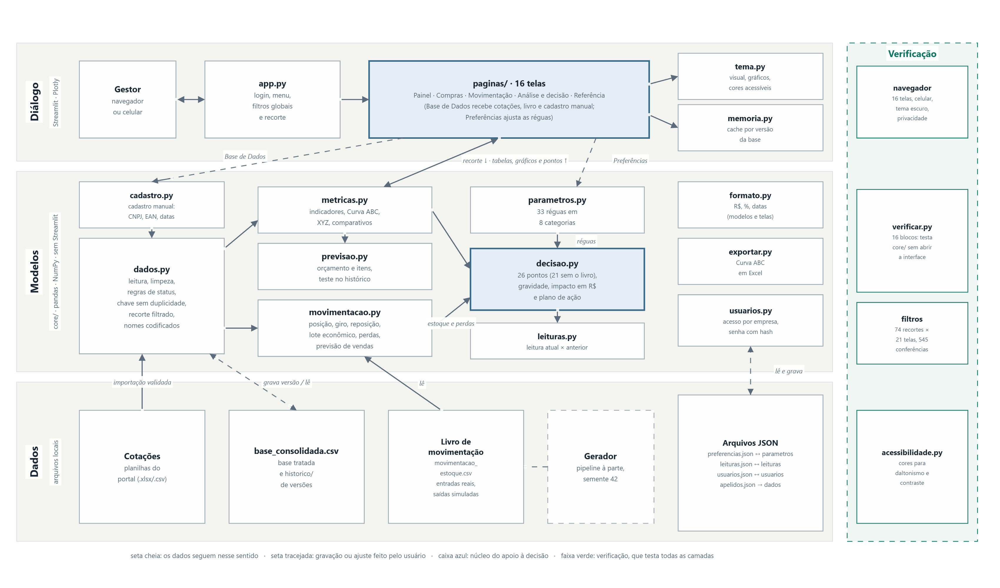

# SADPF — Sistema de Apoio à Decisão para Pequenas Farmácias

Painel web em Python que transforma o histórico de cotações de compra de uma farmácia de
pequeno porte em indicadores, Curva ABC, classificação XYZ, previsões e um plano de ação com
valor em reais. Roda no próprio computador e é acessado pelo navegador.

Desenvolvido como Trabalho de Conclusão de Curso em Engenharia de Sistemas Ciber-Físicos na
Pontifícia Universidade Católica de São Paulo (PUC-SP), 2026, por Izabela de Vasconcelos
Granjeiro, Katywsa Souza de Assis e Sophia de Almeida Virginio Martins, com orientação do
Prof. Dr. Carlos Antonio Sartori e do Prof. Dr. Renan Trevisoli Doria.

> **Este repositório não contém dados.** A base usada no TCC é de uma farmácia real e foi
> cedida só para uso acadêmico, por isso fica fora daqui. Para usar o sistema, você coloca a
> sua própria planilha de cotações na pasta `dados/` (passo 2 abaixo). O `.gitignore` impede
> que esses arquivos sejam enviados ao GitHub.

---

## Como rodar

**Você precisa de:** Python 3.10 ou mais novo (testado com 3.12) e internet na primeira execução.
No Windows, instale o Python por <https://www.python.org/downloads/> e marque
**Add python.exe to PATH**.

**1. Baixe o projeto.** Pelo botão verde **Code › Download ZIP** desta página (e descompacte), ou
pelo Git:

```bash
git clone https://github.com/Artemiza16/sadpf.git
cd sadpf
```

**2. Coloque os seus dados.** Abra `dados/modelo_cotacao.xlsx`. A aba *Cotação* tem as colunas
que o sistema lê, e a aba *Instruções* explica cada uma. Preencha uma linha por item de pedido
(ou cole a exportação do seu portal de cotações com o mesmo cabeçalho) e salve na pasta
`dados/` com o nome **`cotacao_06_09.xlsx`**. O livro de movimentação, que alimenta as telas de
estoque, é opcional (veja `movimentacao/LEIA-ME.txt`).

**3. Abra o painel.**

- **Windows:** dois cliques em `INICIAR_SADPF.bat`.
- **macOS / Linux:** no terminal, dentro da pasta, rode `bash iniciar_sadpf.sh`.

Na primeira vez, o script cria um ambiente Python (`.venv`), instala as bibliotecas, roda a
conferência automática e abre <http://localhost:8501>. Depois disso, abre direto.

**4. Entre** com a empresa `Farmacia` e a senha `123`. Outros acessos podem ser criados na aba
*Criar acesso*.

### Passo a passo manual (qualquer sistema)

```bash
python -m venv .venv
# Windows
.venv\Scripts\python.exe -m pip install -r requirements.txt
.venv\Scripts\python.exe verificar.py
.venv\Scripts\python.exe -m streamlit run app.py
# macOS / Linux
.venv/bin/python -m pip install -r requirements.txt
.venv/bin/python verificar.py
.venv/bin/python -m streamlit run app.py
```

O `verificar.py` confere em 16 blocos o ambiente, os cálculos, os filtros, a importação, o
login, a movimentação, o cadastro manual e as cores, sempre em cópias temporárias, sem alterar
os seus dados. Com dados diferentes dos do TCC, o **bloco 4** aponta diferenças, porque compara
os cálculos com os valores da base original; isso é esperado. Os demais blocos devem passar.

---

## O que o sistema faz

| Grupo | Telas |
|---|---|
| Painel | **Visão Geral**: resultado do mês, situação do período, composição do resultado e prioridades |
| Compras | Gestão de Compras, Pedidos, Fornecedores, Medicamentos |
| Movimentação | Posição de Estoque, Reposição e Lotes (ponto de pedido, lote econômico, dente de serra), Validade e Remarcação |
| Análise e decisão | Curva ABC, Análises e Indicadores (ABC × XYZ, giro, estatística), Previsão de Compras, **Sistema de Apoio à Decisão** (26 pontos com gravidade em reais e plano de ação) |
| Referência | Conceitos e Cálculos (68 verbetes), Tutoriais, Preferências (33 réguas ajustáveis), Base de Dados (importação, cadastro manual e versões) |

Todas as telas respondem aos mesmos filtros de período, fornecedor, categoria, forma
farmacêutica, medicamento, cotação e status. Fornecedores e representantes aparecem
codificados (Fornecedor A, B…) por padrão. O painel funciona no celular e tem tema escuro, e as
cores foram escolhidas para continuar distinguíveis por pessoas com daltonismo.

## Arquitetura

O código segue o paradigma Dados–Modelos–Diálogo (Sprague; Carlson, 1982). Os cálculos de
`core/` não dependem da interface: o `verificar.py` os importa com o Streamlit bloqueado.



```
├── app.py                 entrada: login, menu, filtros globais
├── core/                  regras e cálculos (dados, métricas, ABC/XYZ, decisão, previsão, movimentação)
├── paginas/               as 16 telas
├── dados/                 SEUS dados (vazia no repositório: só o modelo e as instruções)
├── movimentacao/          livro de movimentação (opcional) e scripts do gerador
├── assets/, static/, .streamlit/   logo, fotos e tema
├── verificar.py           conferência automática (16 blocos)
├── gerar_*.py             relatórios, figuras e Curva ABC em Excel
├── docs/                  imagens deste README
├── DOCUMENTACAO.md        documentação técnica completa
└── LEIA-ME.md             guia de uso para quem não programa
```

## Atualizar os dados

Na tela **Base de Dados**:

- **Cotações:** envie uma planilha no mesmo formato. O sistema aplica as regras de limpeza,
  mostra uma prévia, não duplica linhas e guarda uma cópia da versão anterior.
- **Cadastro manual:** um pedido item a item, com as mesmas validações.
- **Movimentação:** envie um livro com as vendas do caixa para medir giro, cobertura e perdas.

As regras de limpeza ficam no topo de `core/dados.py`. Depois de mudar uma regra, apague
`dados/base_consolidada.csv` e o sistema reprocessa a planilha original.

## Relatórios (opcional)

Os documentos de resultados do TCC não fazem parte deste repositório. Os scripts `gerar_*.py`
ficam como referência de como foram produzidos e precisam de dados e de capturas de tela para
rodar. O diagrama da arquitetura pode ser refeito com
`pip install -r requirements-relatorio.txt` e `python gerar_arquitetura.py` (usa o Google Chrome
instalado).

## Problemas comuns

| Sintoma | O que fazer |
|---|---|
| "Nenhuma base de dados encontrada" | Falta o passo 2: salve a planilha em `dados/cotacao_06_09.xlsx` |
| `Faltam colunas na planilha` | A planilha não tem o cabeçalho do `modelo_cotacao.xlsx` |
| `'python' não é reconhecido` | Reinstale o Python marcando *Add python.exe to PATH*, ou use `py` no lugar de `python` |
| `'streamlit' não é reconhecido` | Use `python -m streamlit run app.py` com o Python do `.venv` |
| `ModuleNotFoundError: No module named 'core'` | O terminal não está na pasta do `app.py` |
| `Port 8501 is already in use` | O painel já está aberto; feche-o ou use `--server.port 8502` |
| Esqueci a senha | Apague `dados/usuarios.json`; o acesso volta a ser Farmacia / 123 |

Mais casos e todas as fórmulas estão em [DOCUMENTACAO.md](DOCUMENTACAO.md).

## Licença

Projeto acadêmico. Nenhuma licença de código aberto foi definida até aqui, então os direitos
continuam com a equipe do projeto.
